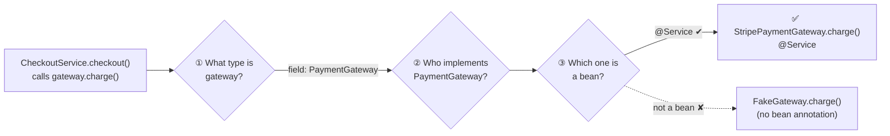
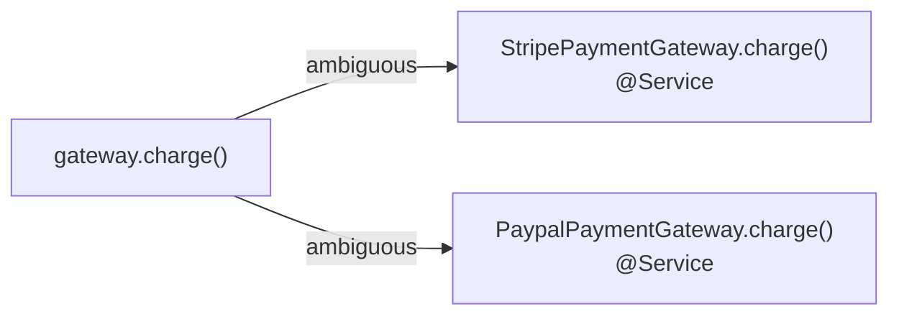
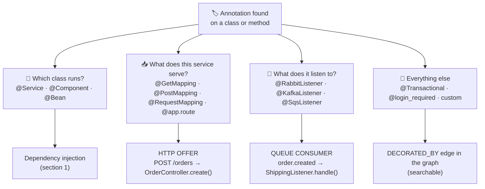
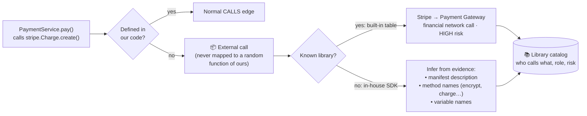
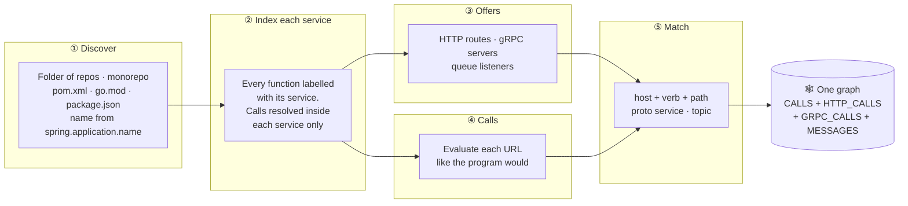
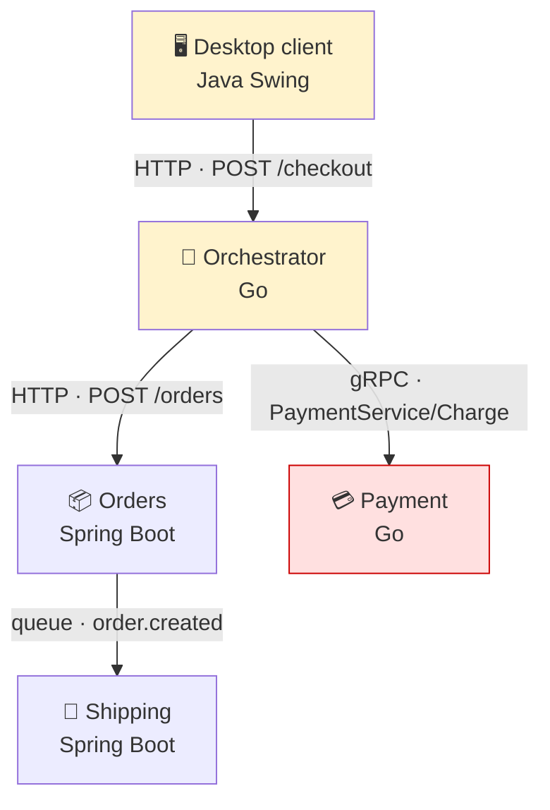
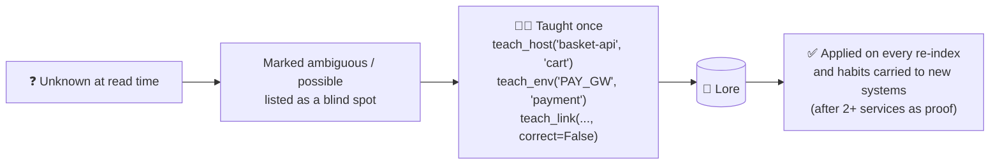

# 🦊 Kitsune — How It Handles the Four Hard Problems

> Answers to the four questions every architect asks about a code-knowledge tool:
> **dependency injection, annotations, external libraries, and multi-repo systems.**
> For each one: the question, the short answer, a picture, an example, and the honest limits.

| # | Question | Short answer |
|---|---|---|
| 1 | [Dependency injection](#1-dependency-injection) | Field type → implementing class → bean annotation. If there are several candidates, the link is marked **ambiguous**, never guessed |
| 2 | [Annotations](#2-annotations) | Read on every function and class; the important ones tell Kitsune **which class runs, what a service serves, and what it listens to** |
| 3 | [External libraries](#3-external-libraries) | No source code needed: every outside call is **recorded and labelled** with its role and risk, including in-house SDKs |
| 4 | [Multi-repo](#4-multi-repo-many-services) | Each service has an **"I offer"** and an **"I call"** list; Kitsune matches them into **one graph** |

**The one rule behind all four:** *Kitsune reads code, it doesn't run it.* Whatever can only be
known at run time is marked **ambiguous** or **possible**, never guessed, and the team can
teach it once ([lore](#5-what-kitsune-cannot-know--and-how-it-learns)).

---

## 1. Dependency injection

### The question
> "In Spring the code calls an **interface**, and the framework plugs in the real class at run
> time. How can a tool that only reads code know which class actually runs?"

### The short answer
Kitsune does what a developer does when reading the code: it finds the class that
**implements** the interface and is **marked as a bean**.

### The picture



### The example

```java
interface PaymentGateway { void charge(); }

@Service                                   // ← the bean Spring will plug in
class StripePaymentGateway implements PaymentGateway {
    public void charge() { ... }
}

class CheckoutService {
    @Autowired PaymentGateway gateway;     // ← typed as the interface
    void checkout() { gateway.charge(); }  // ← which charge() runs?
}
```

**Result in the graph:** `CheckoutService.checkout ──CALLS──▶ StripePaymentGateway.charge`

### What it understands

| Pattern | Example |
|---|---|
| Field injection | `@Autowired PaymentGateway gateway;` |
| Constructor injection | `this.repo = repo` (the parameter's type flows to the field) |
| Bean annotations | `@Service`, `@Component`, `@Repository`, `@Controller`, `@RestController`, `@Bean`, `@Injectable` (Angular / NestJS), `@Singleton` |
| Go | struct fields (`s.ledger.Apply()` → `Ledger.Apply`) |
| Typed locals | `order = Order(...)`, `new ApiClient()`, type annotations |

### When there are several candidates



If two beans implement the same interface, Kitsune uses the same hints Spring does:
- **`@Qualifier("stripe")`** on the field or constructor parameter picks the bean named `stripe`. That's the name in `@Service("stripe")`, or the class name in lowerCamelCase.
- Otherwise, a **`@Primary`** bean wins.
- With no hint, Kitsune links **both** and marks the edges **ambiguous**. Normal answers leave ambiguous edges out, and you can ask for them explicitly. **It never invents certainty.**

### Limits (roadmap)
- Beans declared in Spring XML, Guice modules or Dagger modules are not read.
- A bean picked by configuration (profiles, `@ConditionalOnProperty`) stays ambiguous.

> 💬 **Say it like this:** *"Kitsune resolves injection the way a developer does: field type →
> implementing class → bean annotation. When there are several candidates, it marks the link
> as ambiguous instead of guessing."*

---

## 2. Annotations

### The question
> "So much behaviour lives in annotations and decorators, not in plain calls. Does Kitsune
> see them?"

### The short answer
Yes. Every annotation or decorator is read and stored on its function or class, and the
important ones are **understood**. They do three jobs:



### The example

```java
@RestController
@RequestMapping("/orders")                // class-level prefix
class OrderController {
    @PostMapping                          // → offer: POST /orders
    Order create(@RequestBody Order o) { ... }

    @GetMapping("/{id}")                  // → offer: GET /orders/{*}
    Order get(@PathVariable String id) { ... }
}

@Component
class ShippingListener {
    @RabbitListener(queues = "order.created")   // → consumer of order.created
    void handle(Order o) { ... }
}
```

**What you can ask:** "Which endpoints does orders-service expose?", "Who consumes
`order.created`?", "Which methods are `@Transactional`?"

### Limits (roadmap)
- **Custom annotations** (e.g. an in-house `@AcmeEndpoint`) are stored and searchable, but not
  *understood* as routes until a rule is added. Each one is a one-line addition.

> 💬 **Say it like this:** *"Annotations aren't decoration to Kitsune. They tell it which class
> really runs, what each service serves, and what it listens to."*

---

## 3. External libraries

### The question
> "We call Stripe, Redis, Kafka and our own internal SDKs. We can't index their source code.
> What happens to those calls?"

### The short answer
Kitsune **doesn't need their source code**. It records *that* your code calls the library and
*what kind* of library it is. The boundary is what matters for impact analysis.

### The picture



### Examples of the catalog

| Package | How it was identified | Role | Risk |
|---|---|---|---|
| `stripe` | Built-in table | Payment gateway: financial network call | 🔴 High |
| `redis` | Built-in table | Cache store | 🟡 Medium |
| `requests` / `axios` / `RestTemplate` | Built-in table | HTTP client: outbound network | 🟡 Medium |
| `@acme/vault` *(in-house)* | Manifest says "secret storage", methods `encrypt` / `getSecret` | Authentication & security | 🔴 High |
| `json` | Built-in table | Standard library | 🟢 Low |

**What you can ask:** "Where do we touch Stripe?", "Which code makes financial network calls?",
"What's our riskiest external dependency?"

### Precision guard
The caller's **file name is deliberately not evidence**. `json.dumps()` inside `payments.py`
stays "JSON", not "payment gateway".

### Limits
- Kitsune knows the library's **role**, not its internals. That's intended: we analyse *our use*
  of a library, not the library itself.

> 💬 **Say it like this:** *"We don't index Stripe's code, we index our use of Stripe. Every
> external call is recorded and labelled with its role and risk, our own internal SDKs
> included."*

---

## 4. Multi-repo (many services)

### The question
> "Our services live in separate repos, in different languages, and talk over HTTP, gRPC and
> queues, not function calls. How do they become one graph?"

### The short answer
Every service has an **"I offer"** list and an **"I call"** list. Kitsune matches the two, like
matching the numbers dialled to the phones that ring.

### The pipeline



### How a URL is worked out (step ④)

| Code in the caller | Kitsune evaluates it to | Linked to |
|---|---|---|
| `"http://" + ORDERS_HOST + "/orders"` (a constant) | `http://orders/orders` | **orders** · `/orders` |
| `getenv("CART_ENDPOINT", "cart")` | `cart` (the default) | **cart** |
| `String.format("http://%s/shipping/", host)` | fills in `host` | **shipping** |
| `new ServiceUri("payment", "/paymentAuth").toUri()` | `http://payment/paymentAuth` | **payment** · `/paymentAuth` |
| gateway config `uri: lb://vets-service` | `vets-service` | **vets-service** (gateway route) |
| `https://api.github.com/...` | public internet host | ❌ never linked to our services |

### The result: one system, four languages



**Question:** *"If I change `PaymentService.Charge`, who's affected?"*
**Kitsune walks the graph:** Payment (Go) ⇠ gRPC ⇠ **Orchestrator** (Go) ⇠ HTTP ⇠ **Desktop
client** (Java Swing), with the file and line in each repo.

### Confidence levels

| Level | When | Example |
|---|---|---|
| ✅ **Confirmed** | Host, verb and path all match one route | `orders → payment POST /paymentAuth` |
| 🟡 **Possible** | Path known, host only known at run time | `fetch(baseUrl + "/items")` |
| 🕳️ **Blind spot** | Can't be placed at all | an env var `PAY_GW` that names no service |

### Proof: four public systems

| System | Shape | Precision / recall | First run (unseen) |
|---|---|---|---|
| Sock Shop | 8 repos · Java, Go, Node · HTTP + RabbitMQ | **100% / 100%** | — |
| Online Boutique | 12 services · 5 languages · gRPC | **100% / 100%** | — |
| Spring PetClinic Microservices | 8 services · Spring Cloud gateway | **100% / 100%** | 0% |
| Robot Shop | 12 services · 5 languages · HTTP + AMQP + nginx | **100% / 100%** | 17% |

Zero wrong links in all four. The *first-run* column is the honest expectation for a
brand-new style of code before its patterns are taught.

**Also understood:**
- **Feign clients:** `@FeignClient(name = "customers-service")` interfaces become calls to that service. One with an outside `url` is treated as an external API, never linked.
- **Spring Cloud Config servers:** a service's `<app-name>.yml` on the config server supplies its context path, gateway routes and OAuth2 dependencies.

### Limits (roadmap)
- Kotlin, C# and PHP are parsed (optional grammars), but their web frameworks' routes and HTTP clients (ASP.NET, Ktor, Laravel) aren't read for service links yet. C# gRPC services still link through their `.proto` contract.
- URLs passed through Spring property beans (`sso.getUserInfoUri()`) aren't followed.

> 💬 **Say it like this:** *"Each service says what it offers and what it calls. Kitsune
> evaluates the URLs like the program would, matches the two lists, and draws the network
> calls into the same graph as the function calls: one map across all repos."*

---

## 5. What Kitsune cannot know — and how it learns

Some facts exist **only at run time**: which bean config picks, which URL an env var holds,
what a custom annotation means. Kitsune never guesses them. It marks them and **learns**:



| Problem | What Kitsune does today | Next step |
|---|---|---|
| Several beans for one interface | `@Qualifier` / `@Primary` decide; with no hint, all are linked as **ambiguous** | Profile- or property-based bean choice |
| Bean defined in XML / Guice / Dagger | Not seen | Read those configs |
| Custom annotation | Stored, searchable | Rule list per team |
| URL known only at run time | **Possible** link / blind spot | Taught through the lore |
| URL passed through a Spring properties bean | Service-level dependency found through OAuth2/config; the exact call is missed | Model `@ConfigurationProperties` binding |

> 💬 **The closing line:** *"Kitsune reads code; it doesn't run it. Where only run time knows,
> Kitsune says so instead of guessing. One lesson from the team fixes it permanently."*

---

**See also:**
- [KITSUNE.md](KITSUNE.md): full architecture and the name.
- [MULTI_SERVICE_DESIGN.md](MULTI_SERVICE_DESIGN.md): the multi-service design.
- Tests: `tests/test_di.py`, `tests/test_externals.py`, `tests/test_services.py`, `tests/test_lore.py`.
