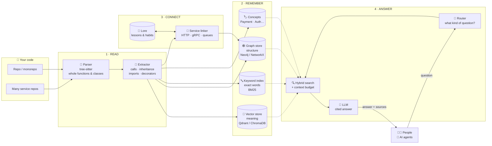
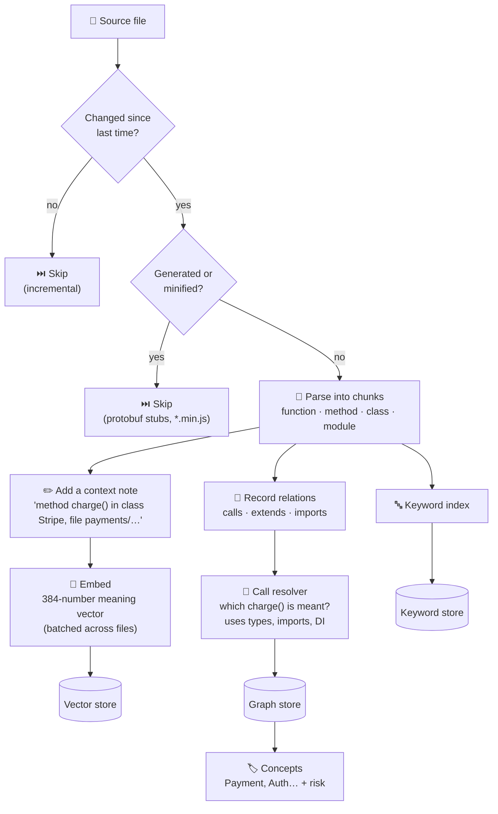
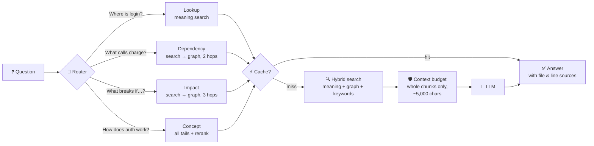
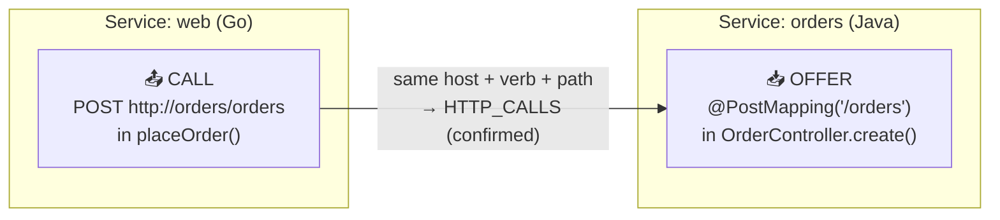
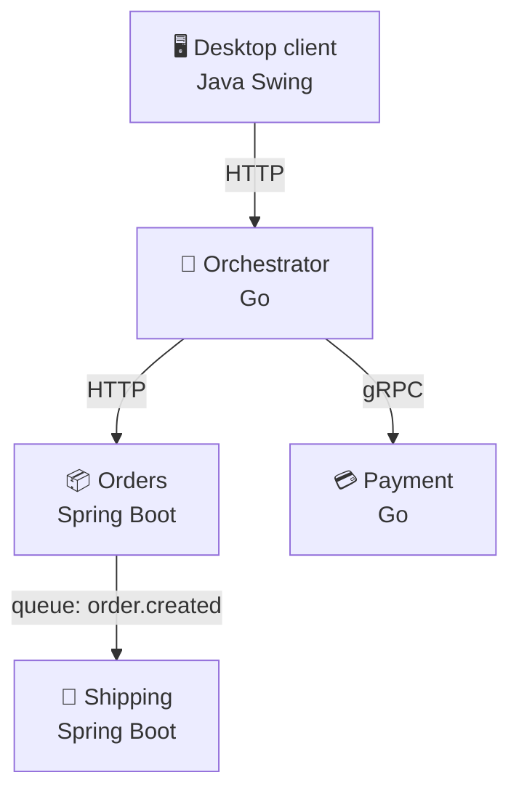
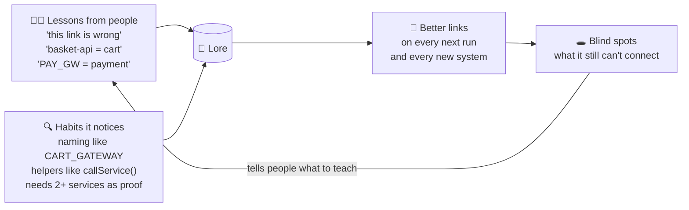
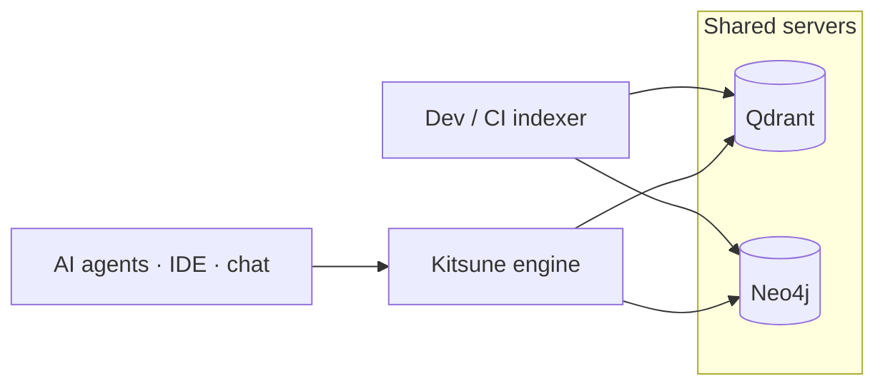

# 🦊 Kitsune — The Code Knowledge Engine

> **Kitsune reads a whole codebase, or a whole system of services, and builds a map of how
> everything connects. People and AI agents can then ask questions about the code and get
> answers that point to the exact code they come from.**

| | |
|---|---|
| **Who it is for** | Engineers, reviewers, architects and AI coding agents |
| **What it answers** | "Where is X?", "What calls X?", "What breaks if I change X?", "How does payment work?", "Which services depend on cart?" |
| **Where it runs** | A laptop (no setup), or shared servers for a team (Qdrant + Neo4j) |
| **Languages** | Python, Java, Go, JavaScript, TypeScript, C, C++, Rust |

**Contents:**
1. [Why the name Kitsune](#1-why-the-name-kitsune)
2. [The problem it solves](#2-the-problem-it-solves)
3. [Architecture at a glance](#3-architecture-at-a-glance)
4. [How Kitsune reads code](#4-how-kitsune-reads-code-indexing)
5. [How Kitsune answers](#5-how-kitsune-answers-a-question)
6. [Many services, one map](#6-many-services-one-map)
7. [Growing with age](#7-growing-with-age-the-lore)
8. [Where data lives and how it is deployed](#8-where-data-lives-and-how-it-is-deployed)
9. [Proven results](#9-proven-results)
10. [Honest limits and roadmap](#10-honest-limits-and-roadmap)
11. [Using it](#11-using-it)
12. [Glossary](#12-glossary)

---

## 1. Why the name Kitsune

In Japanese folklore a **kitsune** (狐) is a fox spirit. It is famous for its intelligence,
its many tails, its power to change shape, its eye for seeing through illusions, and its
role as a messenger between worlds. It grows wiser and gains tails with age.
Each of these traits is a real part of the engine:

| The fox spirit… | Kitsune the engine… |
|---|---|
| 🧠 **is intelligent**: it understands rather than memorises | Understands code **structure** (who calls whom, who inherits from whom), not just the words in the text |
| 🦊 **has many tails**, each a power | Has several search "tails" that work together: **meaning** (vector search), **structure** (graph), **exact words** (keyword search) and **services** (cross-service links) |
| 🔄 **changes shape** to fit any world | Fits any codebase: one repo or many, 8 languages, HTTP, gRPC or queues, a laptop or a server cluster |
| 👁️ **sees through illusions** | Works out what code *really* calls: `new ServiceUri("payment", …)` is the payment service; `getenv("CART_ENDPOINT", "cart")` is cart; `api.github.com` is *not* your catalogue service |
| 📜 **is a messenger between worlds** (the messenger of Inari) | Carries knowledge **between services**: it links a call in one repo to the code that handles it in another |
| ⏳ **grows wiser and gains tails with age** | Has a **lore**: it remembers lessons people teach it and habits it notices, and its *tails* grow as it learns ([section 7](#7-growing-with-age-the-lore)) |
| 🙇 **is honest about what it knows**, a trait of the wise fox | Marks a link **confirmed** only when sure. Otherwise it says **possible**, and it lists its **blind spots** |

---

## 2. The problem it solves

Nobody, human or AI, can hold a large codebase in their head. Ordinary "AI over code" tools
cut files into blocks of N lines and search them by similarity. That breaks in three ways:

| Ordinary approach | What goes wrong | What Kitsune does instead |
|---|---|---|
| Cuts files every N lines | A function is split in half and the AI guesses the rest | Cuts at **real boundaries**: whole functions, methods, classes |
| Searches text only | It finds `checkout()` but not the `charge()` it calls | Builds a **graph** of calls and inheritance, and follows it |
| Looks at one repo | It can't see that the Go gateway calls the Java orders service | **Links services** across repos by their HTTP, gRPC and queue contracts |

---

## 3. Architecture at a glance



**In one sentence each:**
1. **Read:** parse every file into meaningful pieces (*chunks*) and note what each piece calls.
2. **Remember:** store every chunk three ways: by meaning, by structure and by exact words.
3. **Connect:** find where services call each other and draw those links into the same graph.
4. **Answer:** classify the question, gather exactly the right code within a size limit, and let an LLM explain it with sources.

### Code map

```
kitsune/
├── engine/knowledge_engine.py   ← the single entry point (everything goes through here)
├── indexer.py                   ← READ: parallel, incremental indexing
├── parser/                      ← tree-sitter parsing, chunking, call extraction
├── embedder/                    ← meaning vectors (bge-small), context notes, reranker
├── store/                       ← vector, graph and keyword stores (server + local versions)
├── graph/                       ← call resolver, library catalog, traversal
├── services/                    ← CONNECT: discovery, contracts, linker, lore
├── query/                       ← ANSWER: router, hybrid search, cache, budget, synthesizer
├── concepts/                    ← business concepts (Payment, Auth…) with risk scores
├── agents/                      ← investigator (bug → root cause), planner (root cause → fix)
└── eval/ · tests/               ← quality evaluations and unit tests
```

---

## 4. How Kitsune reads code (indexing)



**Key points:**
- **Whole pieces only:** a function is never cut in half.
- **Context notes:** each chunk is embedded with a short note saying *where* it lives, so the meaning search knows its surroundings.
- **Accurate call graph:** when the code calls `charge()`, the resolver uses variable types, imports and dependency injection to find *which* `charge()` is meant, instead of linking every function with that name.
- **Incremental:** only changed files are re-read, and deleted files are removed.
- **Safe skipping:** generated code (protobuf stubs, `*.min.js`, vendored libraries) is left out, because it is huge and nobody asks about it.
- **Libraries:** calls into outside libraries (Stripe, Redis, requests…) are recorded in a **library catalog**, so you can ask "where do we talk to Stripe?".

---

## 5. How Kitsune answers a question



| Question type | Example | What Kitsune does |
|---|---|---|
| **Lookup** | "Show me `process_payment`" | Finds the chunk by meaning or exact name |
| **Dependency** | "What calls `verify_password`?" | Finds the starting function, then walks the graph 2 hops |
| **Impact** | "What breaks if I change `Order.total`?" | Walks the graph 3 hops, upstream and downstream, **across services** if needed |
| **Concept** | "How does the payment flow work?" | Uses every tail, reranks, and adds business concepts |

**Safeguards:**
- **Context budget:** the answer context has a size limit. Whole chunks are dropped rather than cut, so the LLM never sees half a function.
- **Cache:** repeated or reworded questions are answered instantly. The cache is cleared after every re-index, so answers never describe old code.
- **Choice of LLM:** the LLM only *explains* what Kitsune found. It runs on Groq by default and can be changed with `LLM_MODEL`.

---

## 6. Many services, one map

Real systems are many services, often in different languages and repos. Kitsune indexes
each one, labels every chunk with its service, and then **connects them**.

### How the connection is found



1. **Discover services:** a folder of repos, a monorepo with manifests (`pom.xml`, `go.mod`, `package.json`…), or a list you give.
2. **Offers:** what each service *serves*, such as HTTP routes (Spring, Express, gin, gorilla, Flask…), gRPC servers and queue consumers.
3. **Calls:** what each service *calls*. Kitsune evaluates the URL the way the program would: constants, string joins, `String.format`, env-var defaults, constructor values and gateway configs.
4. **Match:** a call is linked to an offer by host + verb + path, by gRPC service, or by queue topic. These become `HTTP_CALLS`, `GRPC_CALLS` or `MESSAGES` edges in the same graph.
5. **Be honest:** a sure match is **confirmed**. A URL only known at run time gives a **possible** link. A public host such as `api.github.com` is never linked to your services.

### Example: one system, four languages



After indexing, one question covers all of it: *"If I change the Payment `Charge` RPC, who is
affected?"* → **Orchestrator** (direct caller), and through it the **Desktop client**, with
the exact files and lines.

---

## 7. Growing with age (the lore)

Like the fox spirit, Kitsune gets wiser with use. It keeps a **lore**, a memory that lasts
between runs:



| How it learns | When it is used |
|---|---|
| **Taught:** you confirm or reject a link, or name a host or env var | Immediately, and on every re-index of that system |
| **Noticed:** a naming habit or in-house HTTP helper | In every later system, once seen in **2 or more different services** (one odd project can't teach it a bad habit) |
| **Blind spots:** calls it couldn't place | Listed so a person knows exactly what to teach |

**Tails:** Kitsune starts with 1 tail and gains one each time its lessons double, up to **9**,
like the legendary *kyūbi no kitsune*, the nine-tailed fox. `engine.kitsune_age()` shows them.

---

## 8. Where data lives and how it is deployed

| Store | Holds | Team / production | Laptop / CI (automatic fallback) |
|---|---|---|---|
| Vector | meaning of each chunk | **Qdrant** | ChromaDB |
| Graph | calls, inheritance, service links | **Neo4j** | NetworkX (saved to disk) |
| Keyword | exact words | BM25 file | BM25 file |
| Lore | lessons and habits | JSON file | JSON file |



- **Namespaces:** many projects can share one server without mixing, because each has its own collection and graph nodes.
- **No setup to try it:** without servers, Kitsune falls back to local stores on its own.
- **Privacy:** code is embedded **locally** (bge-small runs on your machine). Only the final question and the selected code go to the LLM.

---

## 9. Proven results

Every number below was measured. The correct answers were written by hand from the source
code before Kitsune was run.

### Many services: five public systems

| System | Shape | Links: precision / recall | First run, before any fixes |
|---|---|---|---|
| Sock Shop | 8 repos · Java, Go, Node · HTTP + RabbitMQ | **100% / 100%** | 63% recall |
| Online Boutique | 12 services · 5 languages · gRPC | **100% / 100%** | 100% |
| Spring PetClinic Microservices | 8 services · Spring Cloud gateway | **100% / 100%** | 0%, kept unseen |
| Robot Shop | 12 services · 5 languages · HTTP + AMQP + nginx | **100% / 100%** | 17%, kept unseen |
| **Train Ticket** ([report](TRAIN_TICKET_REPORT.md)) | 47 services · Spring RestTemplate + RabbitMQ + gateway | **100% / 100%** | 62%, kept unseen (80% precision) |

- **No wrong links:** 0 links to services that must not be connected.
- **Impact questions:** "who is affected if X changes" is right in all five systems.
- **Production setup:** results are the same on the Qdrant + Neo4j servers.

> **How to read this:** the *first-run* column is the honest expectation for a brand-new
> style of code. Every fix since then is generic, not tuned to one project, and the lore
> lets each team's own conventions be taught once.

### One repository: 44 questions on Kitsune's own code

| Metric | Score |
|---|---|
| Right code found (retrieval recall) | **97.5%** |
| Right code ranked in the top 3 | **90%** |
| "What calls / what does X call": precision and recall | **100% / 100%** |
| Question type recognised (router) | **100%** (97% on reworded questions) |

### Retrieval on public Java projects (Gson, PetClinic, about 30 questions each)

- **Meaning search is the strongest single tail:** 60% top-1 and 87% top-5 on PetClinic; 25% top-1 on Gson, which is harder.
- **Combining tails widens coverage:** on Gson, the right code is in the results for 20 of 28 questions, against 16 with meaning search alone.
- **The reranker did not clearly help** in this test, so it is used only for broad concept questions. Full details are in [BENCHMARK_V2_REPORT.md](BENCHMARK_V2_REPORT.md).

### Speed

About 1,200 chunks (Sock Shop, 8 services) index in about **110 seconds** on a 4-core laptop
CPU. Re-indexing only touches changed files.

---

## 10. Honest limits and roadmap

| Today's limit | Plan |
|---|---|
| Largest tested system is about 1,200 chunks; CPU embedding is the bottleneck | Scale test on a large monorepo; GPU or faster embedding |
| Keyword index and lore are local files | Move both into the shared servers |
| Search can't yet be limited to one service | Service filter on search |
| PHP, Kotlin, C# not yet parsed (C# gRPC services still link by contract) | Add tree-sitter grammars |
| Java enums are not chunked | Add to the Java chunker |
| URLs known only at run time | Reported as *possible*; taught through the lore |
| AI-agent access (MCP server) is experimental | Stabilise and release |

---

## 11. Using it

```python
from kitsune.engine import RepositoryKnowledgeEngine

engine = RepositoryKnowledgeEngine(namespace="shop")

# One repository
engine.index_repository("/code/payments-api")
engine.ask("What happens if I change process_payment?")
engine.get_upstream_callers("verify_password")
engine.get_impact_analysis("Order.total")

# A whole system of services
engine.index_system("/code/shop")            # a folder of repos, or a monorepo
engine.service_map()                         # who calls whom, over what
engine.get_service_links("cart", "in")       # who depends on cart
engine.get_endpoint_callers("/orders", "POST")

# Growing with age
engine.blind_spots()                         # what it could not connect
engine.teach_host("basket-api", "cart")      # teach once, remembered forever
engine.kitsune_age()                         # tails, lessons, habits
```

**Check quality yourself:**
```bash
python kitsune/eval/run_eval.py              # one repo, 44 questions
python kitsune/eval/fetch_external.py        # download the 4 public systems
python kitsune/eval/run_system_eval.py -v    # many services
```

**Further reading:**
- [TRAIN_TICKET_REPORT.md](TRAIN_TICKET_REPORT.md): blind test on the Train Ticket benchmark (47 services).
- [ARCHITECT_QA.md](ARCHITECT_QA.md): how Kitsune handles dependency injection, annotations, external libraries and multi-repo.
- [KITSUNE_ARCHITECTURE.md](KITSUNE_ARCHITECTURE.md): deep technical detail.
- [MULTI_SERVICE_DESIGN.md](MULTI_SERVICE_DESIGN.md): the multi-service design.
- [BENCHMARK_V2_REPORT.md](BENCHMARK_V2_REPORT.md): retrieval benchmark.

---

## 12. Glossary

| Word | Meaning |
|---|---|
| **Chunk** | One meaningful piece of code: a function, method, class or module |
| **Embedding / vector** | A list of numbers that captures what a chunk *means*, so similar meanings are close |
| **Graph** | Nodes (chunks, services) joined by edges (`CALLS`, `EXTENDS`, `HTTP_CALLS`…) |
| **BM25** | A classic exact-word search ranking |
| **Offer / Call** | What a service serves / what it calls on another service |
| **Confirmed / possible** | Sure link / likely link that needs run-time information |
| **Namespace** | A private space for one project on a shared server |
| **Lore** | Kitsune's memory of lessons and habits, which grows with age |
| **Tail** | A search power (meaning, structure, words, services), and a measure of Kitsune's wisdom |

---

<p align="center"><i>🦊 Kitsune: the wise fox that reads your code, connects your services, and grows wiser with every system it sees.</i></p>
