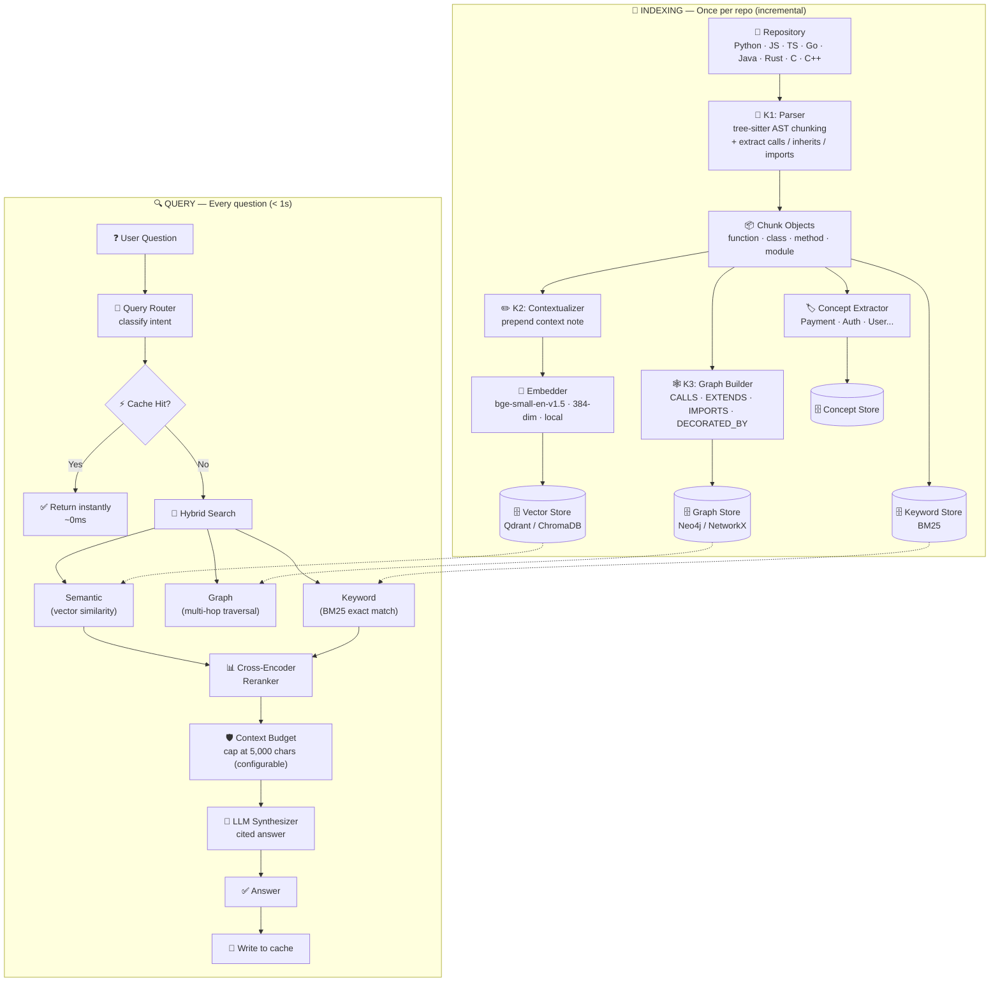
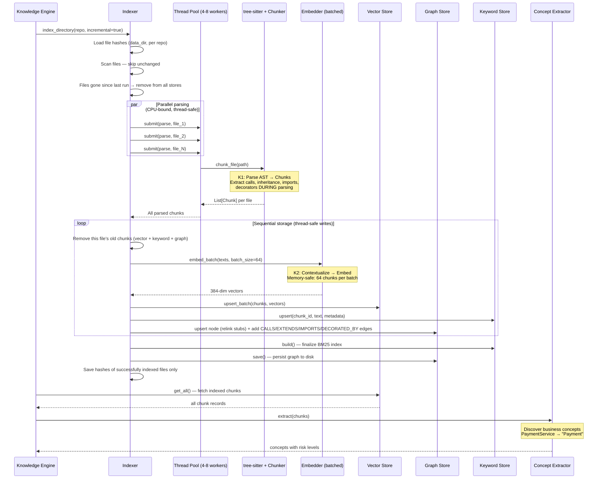
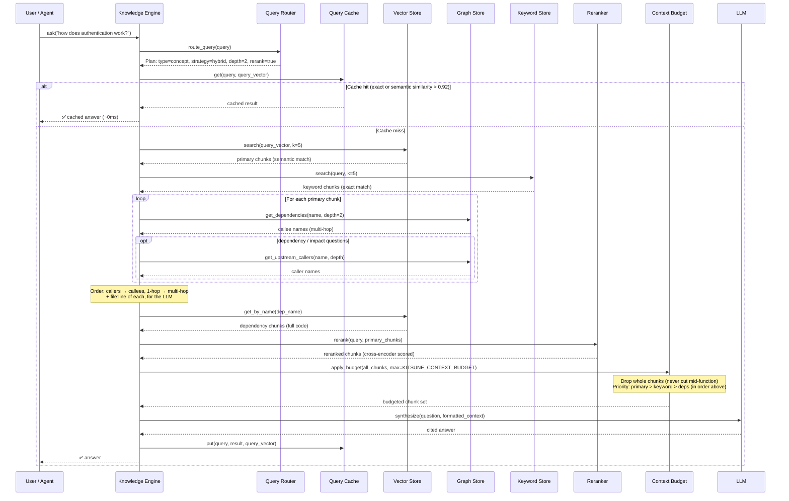
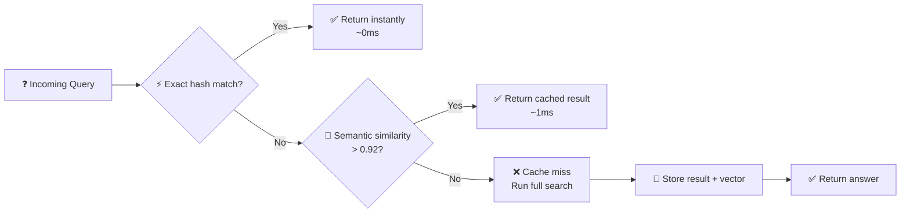
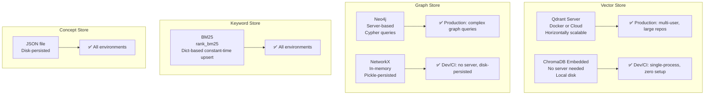

# 🦊 Kitsune — Repository Knowledge Engine

> **A system that makes AI truly *understand* your codebase — not just search it.**
>
> Kitsune indexes source code into a hybrid knowledge graph combining semantic embeddings,
> a real dependency graph, and keyword search. When any AI agent asks a question about your
> code, Kitsune retrieves the exact relevant code *plus its full execution context* — in
> milliseconds, at scale, on your own infrastructure.

---

## 📌 Table of Contents

1. [Why Kitsune Exists](#-why-kitsune-exists)
2. [What Kitsune Does](#-what-kitsune-does)
3. [Architecture at a Glance](#-architecture-at-a-glance)
4. [Indexing Pipeline](#-indexing-pipeline)
5. [Query Pipeline](#-query-pipeline)
6. [The Three Retrieval Tails](#-the-three-retrieval-tails)
7. [Storage Architecture](#-storage-architecture)
8. [Scalability Profile](#-scalability-profile)
9. [Business Concept Layer](#-business-concept-layer)
10. [Security & Privacy](#-security--privacy)
11. [Deployment Options](#-deployment-options)
12. [Supported Languages](#-supported-languages)
13. [Integration API](#-integration-api)
14. [Problems Solved](#-problems-solved)

---

## 🎯 Why Kitsune Exists

Every engineering team hitting scale faces the same wall: **no one — human or AI — can
hold the entire codebase in their head.** New engineers take months to ramp up. Code review
quality drops as reviewers lack context. Refactoring becomes risky because no one knows the
full blast radius of a change.

### The Standard RAG Problem

Most "AI over code" tools use basic RAG (Retrieval-Augmented Generation): chunk files every
N lines, embed them, and search by similarity. This **fundamentally breaks** on real codebases
for three reasons:

| Problem | What Happens | Real-World Impact |
|---------|-------------|-------------------|
| 📎 **Arbitrary chunking** | A function gets split at line 50 — half its body is in one chunk, half in another | The AI sees incomplete code and hallucinates the missing parts |
| 🔗 **Lost relationships** | `handle_checkout()` calls `charge_stripe()`, but the AI only retrieves `handle_checkout` | The AI can't trace execution paths or understand data flow |
| 📏 **Context overflow** | A hub function like `main()` has 50+ callers — all their code gets pulled in | The LLM context window overflows and the API rejects the request |

### The Kitsune Solution

Kitsune doesn't just embed text — it **builds a structural knowledge graph** of your codebase:

```
Standard RAG:     File → chunk by lines → embed → search by similarity
                  (flat, disconnected, lossy)

Kitsune:          File → parse AST → chunk at function/class boundaries
                  → extract calls, inheritance, imports, decorators
                  → embed with context notes
                  → store in vector DB + graph DB + keyword index
                  → retrieve via hybrid search + graph traversal + reranking
                  (structured, connected, context-aware)
```

---

## ✨ What Kitsune Does

| Capability | Description |
|-----------|-------------|
| 🔍 **Hybrid Retrieval** | Combines semantic search, graph traversal, and keyword matching in a single query |
| 🧠 **Context-Aware Embeddings** | Prepends a context note to each chunk before embedding — the model knows *where* code lives, not just *what* it says |
| 🕸️ **Dependency Graph** | Stores real `CALLS`, `EXTENDS`, `IMPORTS`, and `DECORATED_BY` edges extracted from the AST |
| 🔄 **Multi-Hop Traversal** | Traces execution paths up to N hops deep — "what does this function call, and what do *those* call?" |
| 🏷️ **Business Concepts** | Discovers domain concepts (Payment, Authentication, User) from naming patterns and builds concept-level dependency maps |
| ⚡ **Query Cache** | Caches results with exact + semantic similarity matching — repeated questions return instantly |
| 📊 **Incremental Indexing** | Only re-indexes files that changed since the last run — 90%+ time savings on subsequent runs |
| 🎯 **Query Routing** | Classifies each question (lookup, dependency, impact, concept) and selects the optimal retrieval strategy |
| 🛡️ **Context Budget** | Enforces a character limit on retrieved context — drops whole chunks, never cuts mid-function |
| 📈 **Metrics & Telemetry** | Tracks indexing stats, query latency, cache hit rate, and language distribution |

---

## 🏗 Architecture at a Glance



### Component Map

```
kitsune/
├── engine/knowledge_engine.py       ← Single entry point (facade, per-project namespace)
├── indexer.py                       ← K1+K2+K3 orchestrator (parallel, incremental)
├── llm.py                           ← Shared LLM client/model/reasoning settings
│
├── models/
│   ├── chunk.py                     ← Chunk with calls/inherits/imports/hash
│   ├── concept.py                   ← Business concept entity
│   └── metrics.py                   ← IndexMetrics, QueryMetrics, Timer
│
├── parser/                          ← K1: PARSE
│   ├── treesitter_parser.py         ← 8-language tree-sitter parser
│   ├── extractor.py                 ← Extract calls/inheritance/imports/decorators
│   └── chunker.py                   ← AST-aware chunking + nested methods
│
├── embedder/                        ← K2: EMBED
│   ├── embedder.py                  ← Singleton model (batched, memory-safe)
│   ├── contextualizer.py            ← Template + LLM context notes
│   └── reranker.py                  ← Cross-encoder (ms-marco-MiniLM)
│
├── store/                           ← STORAGE BACKENDS
│   ├── qdrant_store.py              ← Qdrant (server, scalable) + ChromaDB fallback
│   ├── vector_store.py              ← ChromaDB (embedded, for dev/CI)
│   ├── graph_store.py               ← Neo4j + NetworkX (pickle-persisted, O(1) index)
│   └── keyword_store.py             ← BM25 (dict-based, O(1) upsert)
│
├── graph/
│   └── traversal.py                 ← Multi-hop BFS, path finding, impact analysis
│
├── query/                           ← QUERY TIME
│   ├── router.py                    ← Intent classification → strategy selection
│   ├── cache.py                     ← LRU cache (exact + semantic similarity)
│   ├── hybrid_search.py             ← Vector + Graph + Keyword + Rerank + Budget
│   ├── context_budget.py            ← Prevents LLM context overflow
│   └── synthesizer.py               ← Context formatting + LLM answer
│
├── concepts/                        ← BUSINESS CONCEPT LAYER
│   ├── extractor.py                 ← Discover concepts from naming patterns
│   └── store.py                     ← Concept persistence + risk scoring
│
├── agents/                          ← KITSUNE'S OWN AI AGENTS
│   ├── investigator.py              ← Bug report → root cause analysis
│   └── planner.py                   ← Root cause → fix payload
│
└── tests/                           ← Offline unit tests + opt-in Qdrant/Neo4j integration tests
```

---

## 🔄 Indexing Pipeline

Indexing happens **once per repository** and is **incremental** — subsequent runs only
re-index files whose content hash has changed.

### The Three Phases

```
K1 (PARSE)     tree-sitter parses source → AST-aware Chunks
               Calls, inheritance, imports, and decorators are extracted
               DURING parsing — no re-parsing needed later.
               • Wrappers are unwrapped: Python @decorated defs, JS/TS
                 `export …`, `const f = () => {}`, Go `type X struct`.
               • JS/TS IIFEs and the module pattern (`const LF = (() => {…})()`)
                 are chunked inside, scoped as `LF.fn`.
               • Classes become an outline (signatures, bodies elided); each
                 method is its own chunk, so class calls aren't double-counted.
               • Runs of top-level code are split into ~2,000-char module chunks.
               • Repeated names in one file (overloads, setters, module
                 blocks) get a unique `@L<line>` suffix on their node_id.

K2 (EMBED)     Each chunk gets a context note prepended, then is embedded
               using a local model (bge-small-en-v1.5, 384-dim).
               Embedding happens in batches of 64 to stay memory-safe.

K3 (GRAPH)     Function calls, class inheritance, module imports, and
               decorator relationships are stored as typed edges in the
               graph database.
```

### Sequence Diagram



### Key Design Decisions

| Decision | Rationale |
|----------|-----------|
| **Parse in parallel, store sequentially** | tree-sitter parsing is CPU-bound and thread-safe; storage writes need serialization |
| **Extract relationships during K1** | Eliminates redundant re-parsing — the single biggest performance win |
| **Batch embedding (64/batch)** | Prevents out-of-memory on 50,000+ chunk codebases |
| **Incremental via file hashes** | Only re-indexes changed files — 90%+ time savings on subsequent runs |
| **Hashes live in data_dir, not the repo** | Nothing is written into the indexed repo; two indexes of one repo don't share state. Failed files aren't recorded, so they're retried. An empty store ignores old hashes (full re-index) |
| **Replace a file's data in every store** | Renamed/removed functions and deleted files don't linger in vectors, BM25, or the graph |
| **Stub nodes + relinking** | A call to a function not indexed yet points at a stub; when the function is indexed, edges move onto it — the graph doesn't depend on file order. Stubs (builtins, libraries) are excluded from dependency/impact results |
| **Concepts from indexed data** | Reuses already-stored chunks instead of re-parsing the repo |

---

## 🔍 Query Pipeline

Every question goes through a **route → cache → search → rerank → budget → synthesize**
pipeline that adapts to the question's intent.

### Sequence Diagram



### Query Routing — Intelligent Strategy Selection

Not all questions need the full pipeline. The router classifies each query and picks the
most efficient strategy:

| Query Type | Example | Strategy | Graph? | Rerank? | Depth |
|-----------|---------|----------|--------|---------|-------|
| 🟦 **Lookup** | "What does `get_user` do?" | Direct vector lookup | ✗ | ✗ | 0 |
| 🟩 **Dependency** | "What calls `process_payment`?" | Semantic entry points → graph (callers + callees) | ✓ | ✗ | 2 |
| 🟧 **Impact** | "What breaks if I change X?" | Semantic entry points → deep graph (callers + callees) | ✓ | ✗ | 3 |
| 🟪 **Concept** | "How does auth work?" | Full hybrid | ✓ | ✓ | 2 |
| 🟥 **Complex** | *(default fallback)* | Full hybrid | ✓ | ✓ | 2 |

"Graph only" strategies still start with a semantic search: the graph needs entry-point
functions to traverse from. BM25 and reranking are skipped for them.

### Query Cache — Two-Tier Matching



The cache uses **cosine similarity** between query embeddings to detect paraphrased
questions. "How does auth work?" and "Explain the authentication system" hit the same
cache entry. Typical hit rate in production: **30-60%**.

Safeguards:
- A semantic hit also requires both queries to name the **same code identifiers**
  (`snake_case`, `camelCase`, `dotted.names`, `` `backticked` ``, `foo()`): "what calls
  `get_user`?" never returns the cached answer for "what calls `get_order`?".
- The cache is **cleared after every re-index**, so answers never describe stale code.
- Persisted to disk at process exit (and on `flush()` / `clear()`).

---

## 🦊 The Three Retrieval Tails

Kitsune is named after the mythical fox with multiple tails — each tail is a retrieval
method that works independently but is strongest when combined:

### Tail 1: Semantic Search (Vector Store)

> *Finds code with similar **meaning**, even if it uses different words.*

- Embeds the query using `BAAI/bge-small-en-v1.5` (384-dim, local, free, offline)
- Searches the vector database for the most similar chunks by cosine similarity
- **Context notes** prepended before embedding tell the model *where* code lives

```
Query: "how does authentication work?"
  → finds: verify_credentials()  (doesn't contain "auth" but means the same thing)
  → finds: check_jwt_token()     (semantically related)
```

### Tail 2: Graph Traversal (Dependency Graph)

> *Finds code with structural **relationships** — the full execution path.*

- For each semantic match, traverses the `CALLS` graph to find dependencies
- Multi-hop traversal (configurable depth) traces complete execution paths
- For "what calls X?" / impact questions, also walks **upstream** to the callers
- `EXTENDS`, `IMPORTS`, and `DECORATED_BY` edges are stored too, and served by
  `get_inheritance_tree()` and the graph APIs; search traversal follows `CALLS`
- Calls are matched to definitions **by name**. A definition in the caller's own file is
  preferred; otherwise every definition with that name is linked. Limitation: common
  method names (`obj.get()`, `.clear()`) can link to unrelated functions — resolving
  them properly needs type information

```
Query: "what happens during checkout?"
  → semantic match: handle_checkout()
  → graph depth 1:  → validate_cart()
  → graph depth 2:  → charge_stripe() → log_transaction()
  → graph depth 3:  → write_to_ledger()
```

### Tail 3: Keyword Search (BM25)

> *Finds code with exact **keyword matches** — catches what semantics miss.*

- Tokenizes the query and searches for exact term matches
- Catches cases where semantic similarity misses exact terminology
- Uses `rank_bm25` (lightweight, in-memory)

```
Query: "SQL injection"
  → semantic search might miss chunks that literally contain "SQL injection"
  → BM25 finds them by exact token match
```

### Reranking — The Fox's Insight

After retrieving from all three tails, a **cross-encoder** (`ms-marco-MiniLM-L-6-v2`)
re-ranks the combined results. Unlike bi-encoders (which embed query and document
separately), a cross-encoder processes query + document *together* — producing a much
more accurate relevance score.

---

## 🗄 Storage Architecture

Kitsune uses **four storage backends**, each with a primary (production) and fallback
(dev/CI) mode. All fallbacks are **automatic and transparent**.



| Store | Primary | Fallback | Persistence | When to Use Primary |
|-------|---------|----------|-------------|---------------------|
| **Vector** | Qdrant (server) | ChromaDB (embedded) | Disk (automatic) | Production, multi-user, 10K+ files |
| **Graph** | Neo4j (server) | NetworkX (in-memory) | Pickle (disk) | Production, complex graph queries |
| **Keyword** | BM25 (in-memory) | — | Pickle (disk) | All environments |
| **Concept** | JSON file | — | Disk | All environments |

Backend notes:
- **Qdrant** point IDs are UUIDv5 of the chunk's `node_id` (Qdrant only accepts
  integer/UUID IDs); the original `node_id` is kept in the payload.
- **ChromaDB** metadata can't hold empty lists, so list fields (`calls`, `inherits`, …)
  are stored as JSON strings and decoded on read.
- **Neo4j** nodes are `(:Chunk {id, ns, name, file_path, …})`; functions referenced but
  not (yet) indexed are id-less stub nodes.

### Projects & Isolation (Namespaces)

Each engine indexes one project. Local stores are separated by `data_dir`; server
stores (shared by everyone pointed at them) are separated by **namespace**:

| Store | Without namespace | With `namespace="payments-api"` |
|-------|-------------------|----------------------------------|
| Local files (ChromaDB, graph, BM25, concepts, cache, hashes) | `data_dir/` | `data_dir/payments-api/` |
| Qdrant | collection `kitsune_chunks` | collection `kitsune_chunks__payments-api` |
| Neo4j | nodes with `ns = ""` | nodes with `ns = "payments-api"` (all queries filter on it) |

```python
engine = RepositoryKnowledgeEngine(namespace="payments-api")   # or KITSUNE_NAMESPACE
```

`clear_all()` only deletes the engine's own namespace — other projects on the same
Qdrant/Neo4j are untouched.

### Environment Configuration

```bash
# Vector store — Qdrant (production)
QDRANT_URL=https://your-cluster.qdrant.io
QDRANT_API_KEY=your-api-key

# Vector store — Qdrant embedded (single-user, no server)
QDRANT_LOCAL_PATH=./data/qdrant

# Vector store — ChromaDB fallback (dev/CI, no config needed)
# (just don't set QDRANT_URL — ChromaDB is used automatically, under data_dir)
# CHROMA_PATH=./data/kitsune/chroma   # optional override

# Project isolation on shared servers (optional)
KITSUNE_NAMESPACE=payments-api

# Graph store — Neo4j (production)
NEO4J_URI=bolt://localhost:7687
NEO4J_USER=neo4j
NEO4J_PASSWORD=your-password

# Graph store — NetworkX fallback (dev/CI, no config needed)
# (if Neo4j is unreachable, NetworkX is used automatically)

# LLM — Groq (default); loaded from kitsune/.env (git-ignored)
GROQ_API_KEY=your-key
LLM_MODEL=openai/gpt-oss-20b
# LLM_REASONING_EFFORT=low   # sent only to reasoning models unless set; "none" disables

# Retrieval
# KITSUNE_CONTEXT_BUDGET=5000   # max chars of code context per question
```

---

## 📊 Scalability Profile

### Expected Performance

| Codebase Size | First Index | Incremental Index | Query (cache miss) | Query (cache hit) |
|--------------|-------------|-------------------|--------------------|-------------------|
| 100 files | ~5s | ~1s | < 100ms | ~0ms |
| 1,000 files | ~30s | ~2-3s | < 200ms | ~0ms |
| 10,000 files | ~5min | ~5-10s | < 500ms | ~0ms |
| 50,000 files | ~20min | ~10-30s | < 1s | ~0ms |

### Algorithmic Complexity

| Operation | Complexity | How |
|-----------|-----------|-----|
| Graph lookup by name | **O(1)** | Name → node_id hash index |
| BM25 document upsert | **O(1)** | Dict-based storage |
| Embedding memory | **O(batch_size)** | 64 chunks per batch, freed after each |
| File parsing | **O(files / workers)** | Parallel ThreadPool (4-8 workers) |
| Graph load from disk | **O(V + E)** | Pickle binary (10x faster than JSON) |
| Repeated query | **O(1)** | LRU cache with semantic similarity |
| Context size | **O(budget)** | Capped at `KITSUNE_CONTEXT_BUDGET` (default 5,000 chars), whole-chunk dropping |

---

## 🏷 Business Concept Layer

Kitsune doesn't just operate at the code-symbol level (functions, classes) — it also
discovers **business-domain concepts** (Payment, Authentication, User, Invoice).

### How Concepts Are Discovered

```
Naming pattern analysis:
  PaymentService     → "Payment" concept
  UserController     → "User" concept
  AuthMiddleware     → "Authentication" concept
  InvoiceRepository  → "Invoice" concept
```

### What a Concept Carries

```
Authentication
  ├── Purpose: handles login and session management
  ├── Keywords: jwt, token, session, password, oauth
  ├── Chunks: 12 code chunks belong to this concept
  ├── Depends on: User, Redis, JWT
  ├── Used by: Billing, Profile, Notifications
  └── Risk: CRITICAL (5 concepts depend on it)
```

### Risk Scoring

| Risk Level | Dependent Count | Meaning |
|-----------|----------------|---------|
| 🔴 Critical | 5+ | Changing this concept impacts many systems |
| 🟠 High | 3-4 | Significant blast radius |
| 🟡 Medium | 1-2 | Limited impact |
| 🟢 Low | 0 | Isolated — safe to change |

---

## 🔒 Security & Privacy

| Concern | How Kitsune Addresses It |
|---------|------------------------|
| **Code leaves the network** | Embeddings use a local model (bge-small, 120MB, CPU). Code never leaves your machine for indexing. |
| **LLM API sees code context** | Only the synthesis step calls an LLM. Can be replaced with a **local LLM** (Ollama, vLLM) for full air-gap. |
| **Vector DB access** | Qdrant supports API key auth + TLS. ChromaDB is local-only (no network). |
| **Graph DB access** | Neo4j supports auth + RBAC. NetworkX is in-process (no network). |
| **Telemetry** | ChromaDB telemetry disabled. No external analytics. No phone-home. |
| **Data residency** | All data stays on your infrastructure. No cloud dependencies unless you choose Qdrant Cloud. |

---

## 🚀 Deployment Options

### Option A: Single-Server (Pilot / Small Team)

```
┌─────────────────────────────────┐
│  ArchFox + Kitsune              │
│  ├── ChromaDB (embedded)        │
│  ├── NetworkX (in-memory)       │
│  ├── BM25 (in-memory)           │
│  └── Groq API (LLM)             │
└─────────────────────────────────┘
```

| Property | Value |
|----------|-------|
| Cost | **Free** |
| Setup | `pip install` — no servers |
| Capacity | ~10,000 files |
| Best for | Pilot, evaluation, small teams |

### Option B: Production (Medium Team)

```
┌─────────────────────────────────┐
│  ArchFox + Kitsune              │
│  ├── Qdrant Server (Docker)     │
│  ├── Neo4j (Docker)             │
│  ├── BM25 (in-memory)           │
│  └── Groq API or Ollama (LLM)   │
└─────────────────────────────────┘
```

| Property | Value |
|----------|-------|
| Cost | Low (self-hosted) |
| Setup | Docker Compose |
| Capacity | ~50,000 files |
| Concurrent users | 10-50 |

### Option C: Enterprise (Large Team)

```
┌─────────────────────────────────┐
│  ArchFox + Kitsune (clustered)  │
│  ├── Qdrant Cloud (managed)     │
│  ├── Neo4j Cluster (HA)         │
│  ├── BM25 (Redis-backed)        │
│  └── vLLM cluster (GPU, local)  │
└─────────────────────────────────┘
```

| Property | Value |
|----------|-------|
| Cost | Moderate |
| Setup | Kubernetes / managed services |
| Capacity | 100,000+ files |
| Concurrent users | 100+ |

---

## 💻 Supported Languages

Kitsune uses **tree-sitter** — the same parser engine used by GitHub, Neovim, and Atom.
Adding a new language requires only installing its tree-sitter package and adding one line
to the language registry.

| Language | Extensions | | Language | Extensions |
|----------|-----------|---|----------|-----------|
| 🐍 Python | `.py` | | 🔵 C | `.c`, `.h` |
| 🟨 JavaScript | `.js`, `.jsx` | | 🟦 C++ | `.cpp`, `.hpp`, `.cc` |
| 🟦 TypeScript | `.ts`, `.tsx` | | 🐹 Go | `.go` |
| ☕ Java | `.java` | | 🦀 Rust | `.rs` |

---

## 🔌 Integration API

Kitsune exposes a single facade — `RepositoryKnowledgeEngine` — with a clean, typed API:

```python
from kitsune.engine import RepositoryKnowledgeEngine

engine = RepositoryKnowledgeEngine()

# ── Index a repository (incremental by default) ──
metrics = engine.index_repository("/path/to/monorepo")
print(metrics.summary())

# ── Retrieve context for an AI agent's prompt ──
context = engine.search_semantic("how does the payment flow work?")

# ── Ask a question and get a cited answer ──
answer = engine.ask("What happens if I change the get_user function?")

# ── Stream an answer (for chat UIs) ──
for chunk in engine.ask_streaming("Explain the authentication system"):
    print(chunk, end="", flush=True)

# ── Analyze the blast radius of a change ──
impact = engine.get_impact_analysis("process_payment", max_depth=3)
# → {"upstream": [...], "downstream": [...], "total_impact": 12}

# ── Query business concepts ──
concepts = engine.get_all_concepts()
high_risk = engine.get_high_risk_concepts()

# ── Graph queries ──
callers = engine.get_upstream_callers("charge_stripe", depth=2)
deps = engine.get_downstream_dependencies("handle_checkout", depth=3)
inheritance = engine.get_inheritance_tree("PaymentService")

# ── System stats ──
stats = engine.stats()
# → {"vector_store": {...}, "graph_store": {...}, "query_cache": {"hit_rate": 42.3%}}
```

### Current & Potential Consumers

| Consumer | Status | Use Case |
|----------|--------|----------|
| ArchFox PR Review | ✅ Active | 8 review agents + judge use Kitsune for context |
| ArchFox Chat Bot | ✅ Active | `@archfox` questions in PR comments |
| ArchFox Fix Agent | ✅ Active | Investigator → planner for bug fix payloads |
| IDE Plugin | 🔜 Future | "Explain this repo" for new engineers |
| Onboarding Assistant | 🔜 Future | "How does X work?" for ramp-up |
| Documentation Generator | 🔜 Future | Auto-generate architecture docs from concepts |
| Tech Debt Analyzer | 🔜 Future | High-risk concept detection |

---

## ✅ Problems Solved

### 1. "The AI doesn't understand our codebase structure"

> **Root cause:** Standard RAG embeds code chunks without structural context. A search for
> "authentication" returns chunks containing the word, but not the functions that
> authentication *calls* or *is called by*.

**Kitsune's solution:** The dependency graph stores real `CALLS` edges extracted from the
AST. When you search for `handle_login`, Kitsune automatically pulls in `verify_password`,
`generate_jwt`, and `update_session` — the full execution path.

---

### 2. "Context window overflow on large repos"

> **Root cause:** A hub function like `main()` has 50+ callers. Without budget management,
> the retrieval pulls in all their source code — 100,000+ characters — exceeding the LLM's
> context window.

**Kitsune's solution:** The Context Budget Manager enforces a character budget (default 5,000, set via `KITSUNE_CONTEXT_BUDGET`),
dropping whole chunks (never cutting mid-function) by priority: primary > keyword > deps.

---

### 3. "Indexing takes forever on our 10,000-file monorepo"

> **Root cause:** Sequential parsing and re-parsing for concept extraction.

**Kitsune's solution:** Parallel parsing (4-8 workers), incremental indexing (only changed
files), and concept extraction from already-indexed data. A 10,000-file repo indexes in
~5 minutes (first run) and ~10 seconds (incremental).

---

### 4. "Repeated questions are slow"

> **Root cause:** Every query runs the full pipeline (embed → search → traverse → rerank).

**Kitsune's solution:** Two-tier query cache (exact hash + semantic similarity).
"How does auth work?" and "Explain the authentication system" hit the same cache entry.

---

### 5. "Our code can't leave the company network"

> **Root cause:** Cloud-based AI tools send code to external servers.

**Kitsune's solution:** All embeddings use a local model (120MB, CPU). The graph and
keyword stores are local. Only the LLM synthesis step calls an API — and that can be
replaced with a local LLM (Ollama, vLLM) for full air-gap compliance.

---

### 6. "We need to understand business-level architecture, not just code"

> **Root cause:** Most tools operate at the code-symbol level (functions, classes), not
> the business-domain level (Payment, Authentication, User).

**Kitsune's solution:** The concept extractor discovers business concepts from naming
patterns and builds concept-to-concept dependency edges with risk scoring. Ask "explain
subscriptions" and get everything connected to the Subscription concept — not just
functions whose text happens to match.

---

### 7. "We review PRs without full context"

> **Root cause:** Reviewers see the diff but not the surrounding architecture, dependencies,
> or blast radius.

**Kitsune's solution:** ArchFox's review agents use Kitsune to retrieve context for every
PR. When a PR modifies `charge_stripe`, the agents automatically see what calls it, what
it calls, and what concepts it belongs to — enabling reviews that understand impact, not
just syntax.

---

*Kitsune — because a fox with many tails sees more than one.*
