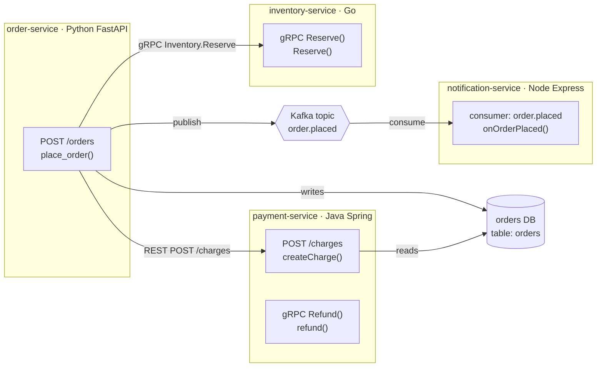
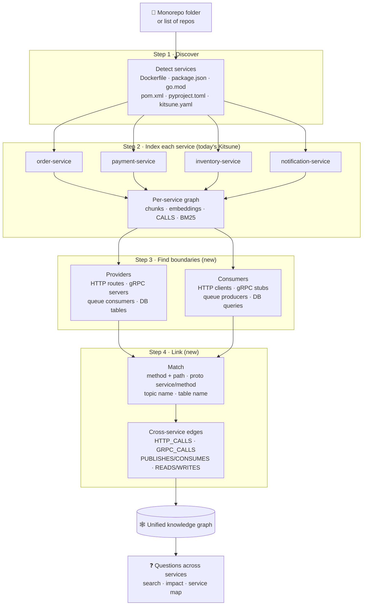
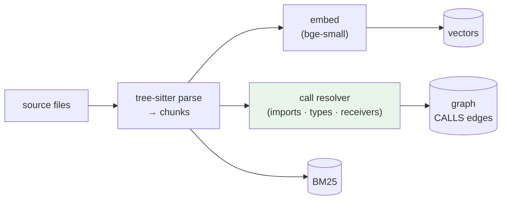
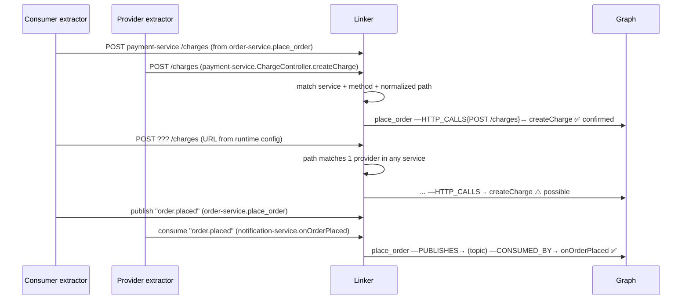
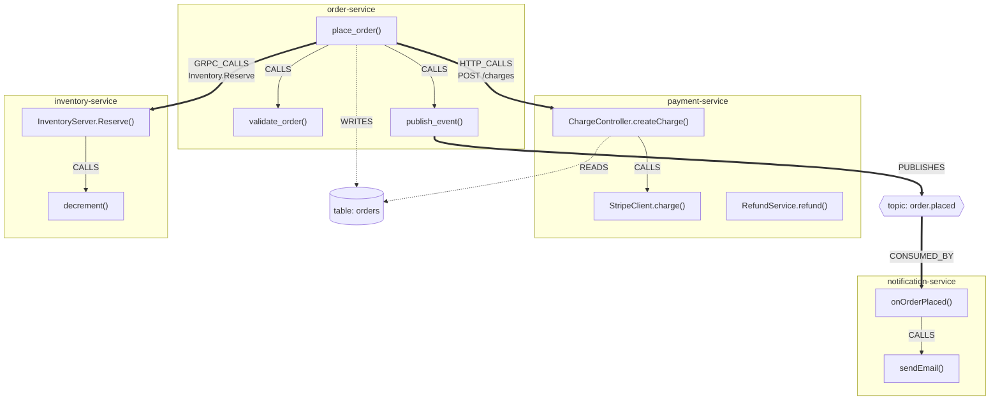
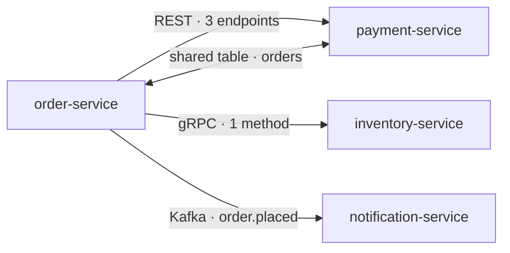
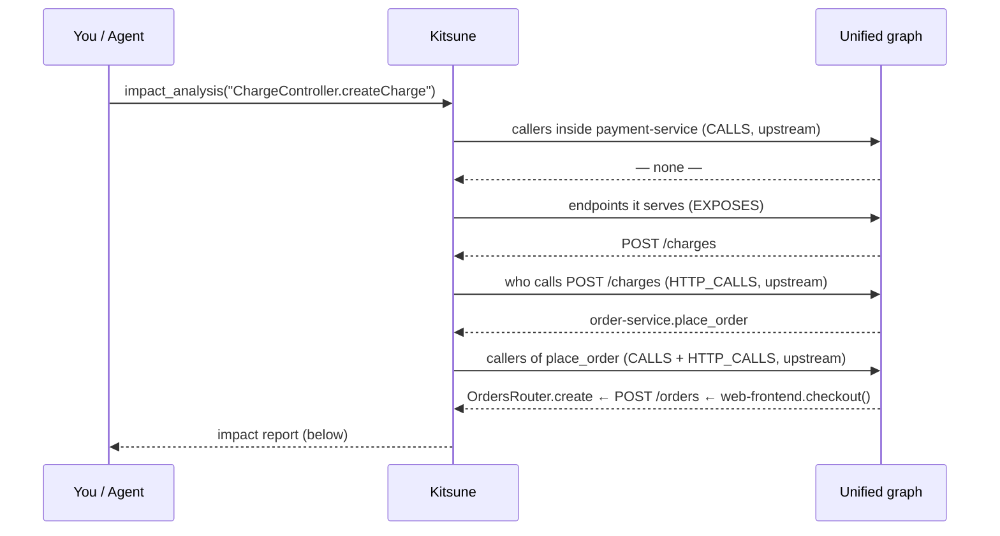

# 🦊 Kitsune for Microservices — One Knowledge Graph Across Services

> **Status: proposed design — not implemented yet.**
> Today Kitsune builds an accurate graph *inside* each service. This document describes
> how it will connect services to each other (REST, gRPC, queues, shared databases) so
> that one knowledge graph covers the whole system.

---

## 📌 Contents

1. [The Problem](#-the-problem)
2. [Example System](#-example-system)
3. [How It Works — Overview](#-how-it-works--overview)
4. [Step 1 — Discover Services](#step-1--discover-services)
5. [Step 2 — Index Each Service](#step-2--index-each-service)
6. [Step 3 — Find Service Boundaries](#step-3--find-service-boundaries)
7. [Step 4 — Link Services Together](#step-4--link-services-together)
8. [The Unified Knowledge Graph](#-the-unified-knowledge-graph)
9. [Asking Questions Across Services](#-asking-questions-across-services)
10. [Confidence — Confirmed vs Possible Links](#-confidence--confirmed-vs-possible-links)
11. [Storage Layout](#-storage-layout)
12. [Agent Tools (MCP)](#-agent-tools-mcp)
13. [Limits](#-limits)
14. [How We'll Measure It](#-how-well-measure-it)
15. [Rollout Plan](#-rollout-plan)

---

## 🎯 The Problem

Inside one service, code talks through **function calls** — Kitsune already resolves
those precisely (imports, types, receivers, inheritance).

Between services, code talks over the **network**. To a parser, the link is invisible:

```text
order-service (Python)                       payment-service (Java)
──────────────────────                       ──────────────────────
def place_order(order):                      @PostMapping("/charges")
    httpx.post(f"{PAYMENTS}/charges", ...)   public Charge createCharge(...) { ... }
            │                                              ▲
            └──────── no function call links these ────────┘
```

Today Kitsune sees `httpx.post` as "a call into an external library" and stops.
So the most valuable microservice question — *"if I change `createCharge`, what breaks in
other services?"* — can't be answered. This design adds those missing links.

---

## 🏗 Example System

Used throughout this document: four services, four languages, three ways of talking.



Repository layout can be anything — Kitsune treats each service as its own unit either way:

```text
Option A — monorepo                 Option B — separate repos
──────────────────                  ─────────────────────────
platform/                           ~/code/order-service/
├── order-service/                  ~/code/payment-service/
├── payment-service/                ~/code/inventory-service/
├── inventory-service/              ~/code/notification-service/
├── notification-service/
└── proto/  (shared .proto files)
```

---

## 🔄 How It Works — Overview



Steps 1 and 2 reuse what Kitsune already does. Steps 3 and 4 are new.

---

## Step 1 — Discover Services

Each top-level folder (or each repo you pass in) that looks like a deployable unit
becomes a **service**.

| Signal | Example |
|--------|---------|
| `Dockerfile` / `docker-compose.yml` service | `order-service/Dockerfile` |
| Package manifest | `package.json`, `go.mod`, `pom.xml`, `build.gradle`, `pyproject.toml` |
| Kubernetes / Helm manifests | `deployment.yaml` with `name: payment-service` |
| Explicit config (overrides everything) | `kitsune.yaml` below |

```yaml
# kitsune.yaml — optional, for anything auto-detection gets wrong
services:
  order-service:    { path: order-service,   base_url_env: ORDER_URL }
  payment-service:  { path: payment-service, base_url_env: PAYMENTS }
  inventory-service:{ path: inventory-service }
shared:
  - proto/          # .proto files used by several services
  - libs/common/    # shared library code (calls into it link normally)
```

`base_url_env` tells Kitsune that a URL built from `PAYMENTS` points at
`payment-service` — the most useful hint for REST links.

---

## Step 2 — Index Each Service

Exactly today's pipeline, run per service, with every chunk and graph node tagged with
its `service`:



One rule changes: **in-code call resolution stays inside a service** (plus shared
libraries it actually imports). Two services both having a `save()` function will
never be linked by name.

---

## Step 3 — Find Service Boundaries

For every service, Kitsune extracts the **providers** (what it exposes) and
**consumers** (what it calls on other services) — each attached to the exact
function that owns it.

### What gets recognised

| Channel | Provider side (exposes) | Consumer side (calls) |
|---------|------------------------|-----------------------|
| **REST — Python** | FastAPI `@app.post("/orders")`, Flask `@app.route` | `requests` / `httpx` `.get/.post(...)` |
| **REST — Node** | Express `app.get("/x", h)`, `router.post(...)` | `fetch(...)`, `axios.get/post(...)` |
| **REST — Java** | Spring `@GetMapping` / `@PostMapping` / `@RequestMapping` | `RestTemplate`, `WebClient`, Feign `@FeignClient` interfaces |
| **REST — Go** | `http.HandleFunc`, `mux/chi/gin` `r.GET(...)` | `http.Get/Post`, `http.NewRequest` |
| **gRPC (all)** | `.proto` `service` + generated server implementation | generated client stub calls `client.Reserve(...)` |
| **Kafka / RabbitMQ / SQS** | consumer: `@KafkaListener(topics=…)`, `consumer.subscribe([...])`, `channel.consume(q)` | producer: `producer.send(topic, …)`, `basic_publish`, `send_message(QueueUrl=…)` |
| **Shared database** | ORM models / migrations defining table `orders` | SQL strings & ORM queries touching `orders` |

### Turning code into comparable endpoints

```text
Consumer (order-service)                         normalized
httpx.post(f"{PAYMENTS}/charges", json=…)    →   POST  payment-service  /charges
httpx.get(f"{PAYMENTS}/charges/{cid}")       →   GET   payment-service  /charges/{*}

Provider (payment-service)
@PostMapping("/charges")                     →   POST  payment-service  /charges
@GetMapping("/charges/{id}")                 →   GET   payment-service  /charges/{*}
```

Path parameters (`{id}`, `:id`, `<int:id>`, `{cid}`, `123`) all normalize to `{*}`.
String constants and f-string pieces are followed where they're visible in code.

---

## Step 4 — Link Services Together



| Channel | Matching key | Typical confidence |
|---------|-------------|--------------------|
| gRPC | proto package + service + method | ✅ highest — names are explicit |
| Queues | topic / queue name (constants followed) | ✅ high |
| REST | target service + HTTP method + normalized path | ✅ when the base URL is known, ⚠️ when inferred from path only |
| Database | table name | ⚠️ shared-table coupling (read/write), not a call |

---

## 🕸 The Unified Knowledge Graph



**Node types:** `Chunk` (functions/classes, as today) · `Service` · `Endpoint`
(REST route / gRPC method) · `Topic` · `Table`.

**Edge types:** today's `CALLS`, `EXTENDS`, `IMPORTS`, `DECORATED_BY`, plus
`HTTP_CALLS`, `GRPC_CALLS`, `PUBLISHES`, `CONSUMED_BY`, `READS`, `WRITES`,
`EXPOSES` (service → endpoint) — each with `confidence: confirmed | possible`.

Zoomed out, the same graph gives a **service map**:



---

## ❓ Asking Questions Across Services

### "What breaks if I change `createCharge`?"



```text
Impact of payment-service · ChargeController.createCharge  (POST /charges)

  confirmed
    order-service      place_order()          order/service.py:42      via REST POST /charges
    order-service      create_order_route()   order/api.py:18          calls place_order
    web-frontend       checkout()             src/checkout.ts:77       via REST POST /orders
  possible
    billing-batch      retry_failed()         jobs/retry.py:12         URL built from config
  shared data
    order-service writes table `orders`, which createCharge reads
```

### Other questions it answers

| Question | How |
|----------|-----|
| "How does an order flow through the system?" | semantic search + follow `HTTP/GRPC/PUBLISHES` edges across services |
| "Which services call payment-service, and how?" | service map edges |
| "Who consumes `order.placed`?" | `Topic` node → `CONSUMED_BY` |
| "Is `/charges/{id}` still used?" | `Endpoint` with no incoming `HTTP_CALLS` → dead-endpoint candidate |
| "Which services touch the `orders` table?" | `Table` node → `READS` / `WRITES` |

---

## 🎚 Confidence — Confirmed vs Possible Links

Same principle as Kitsune's in-code call resolver today: be explicit about certainty.

| Confirmed ✅ | Possible ⚠️ |
|-------------|------------|
| gRPC call to a method defined in a `.proto` | REST call whose base URL comes from runtime config |
| REST call with a known base URL (`base_url_env`, constant) and matching route | path matches routes in several services |
| Producer and consumer use the same topic constant | topic name built dynamically |
| | two services share a table (coupling, not a direct call) |

Default answers use confirmed links; "possible" links are listed separately so an
engineer or agent can verify them.

---

## 🗄 Storage Layout

Works with both local (ChromaDB + NetworkX) and server (Qdrant + Neo4j) backends.

```text
namespace: platform                          ← the whole system
├── service: order-service          chunks, CALLS (internal)
├── service: payment-service        chunks, CALLS (internal)
├── service: inventory-service      chunks, CALLS (internal)
├── service: notification-service   chunks, CALLS (internal)
└── cross-service layer             Service, Endpoint, Topic, Table nodes
                                    HTTP_CALLS, GRPC_CALLS, PUBLISHES, CONSUMED_BY, READS, WRITES
```

- Every chunk/node carries `service`, so searches can be **system-wide** or
  **filtered to one service**.
- **Incremental:** editing `order-service` re-indexes only its changed files, then
  re-runs boundary linking (cheap — it works on extracted endpoints, not source).
- Several systems can still share one Qdrant/Neo4j via namespaces.

---

## 🔌 Agent Tools (MCP)

Existing tools gain a `service` filter; new ones cover the cross-service layer:

| Tool | What it returns |
|------|-----------------|
| `index_system(path or repos[])` | discovers services, indexes all, links boundaries |
| `search_code(question, service?)` | context across the system or one service |
| `impact_analysis(symbol)` | callers **across services**, with the channel (REST/gRPC/queue) |
| `service_map()` | services and how they talk (endpoints, topics, tables) |
| `find_endpoint_callers("POST /charges")` | every consumer of an endpoint |
| `list_endpoints(service)` | routes / RPCs / topics a service exposes |

---

## ⚠️ Limits

- **Runtime-built targets:** URLs or topic names assembled from config files, service
  discovery, or API gateway rewrites are only partly recoverable → marked *possible*.
  `kitsune.yaml` (`base_url_env`, gateway route maps) closes most of the gap.
- **Framework coverage:** the frameworks listed above first; others (NestJS
  decorators, Micronaut, Echo, aiohttp, …) are additional extractors in the same
  shape.
- **Non-code wiring:** links that exist only in infrastructure (Istio routes, AWS
  EventBridge rules, cron triggers) aren't visible in source code.
- **Dynamic dispatch inside services:** same limit as today — resolved through
  imports/types/receivers; unresolvable calls are *possible*, not guessed.

Expect most connections of a typical REST/gRPC/queue codebase — not 100%.

---

## 📏 How We'll Measure It

Same approach as `eval/run_eval.py`: a fixture system with known answers.

```text
eval/repos/platform/
├── order-service/        Python FastAPI   — REST client, gRPC client, Kafka producer
├── payment-service/      Java Spring      — REST provider, gRPC provider
├── inventory-service/    Go               — gRPC provider
├── notification-service/ Node Express     — Kafka consumer
└── proto/                inventory.proto, payments.proto
```

| Metric | Meaning |
|--------|---------|
| link precision / recall | cross-service edges found vs ground truth, per channel |
| cross-service impact F1 | `impact_analysis` across services vs ground truth |
| false links between services | must stay ~0 (same-named functions in different services) |
| existing metrics | in-service retrieval / graph scores must not regress |

---

## 🚀 Rollout Plan

| Phase | Delivers | Answers |
|-------|----------|---------|
| **1. Services** | discovery, `service` tag, per-service resolution, filtered search | "search only payment-service" |
| **2. gRPC + queues** | `.proto` parsing, producer/consumer extraction, linking | "who consumes order.placed?", "who calls Reserve?" |
| **3. REST** | route + client extractors for FastAPI/Flask, Express, Spring, Go; path matching; `kitsune.yaml` | "who calls POST /charges?" |
| **4. Cross-service queries** | impact across services, service map, MCP tools | "what breaks if I change createCharge?" |
| **5. Shared data** | table extraction from SQL/ORM | "who touches the orders table?" |

Each phase ships with fixture questions in the eval, so every step is measured.

---

*Kitsune — because a fox with many tails sees more than one service.*
