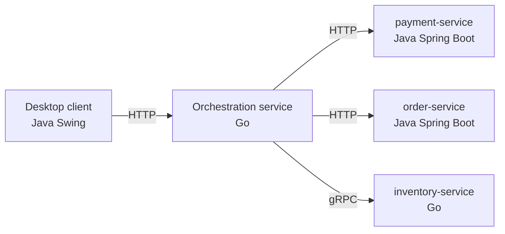
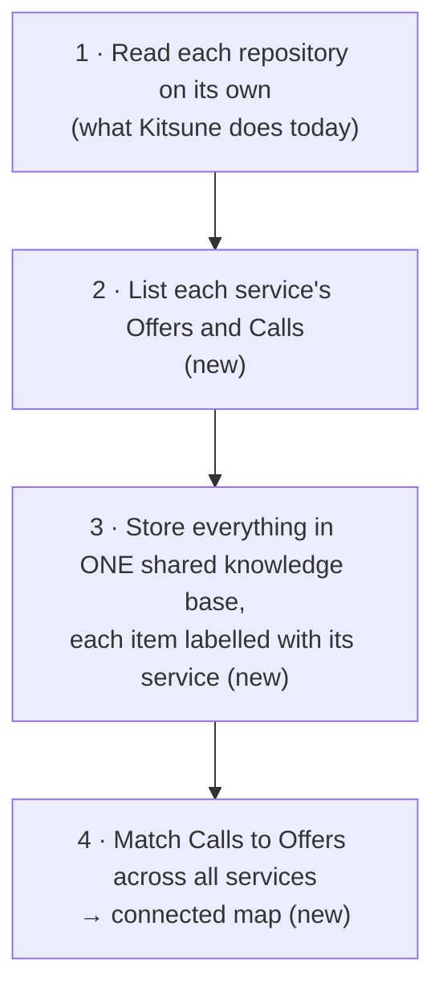
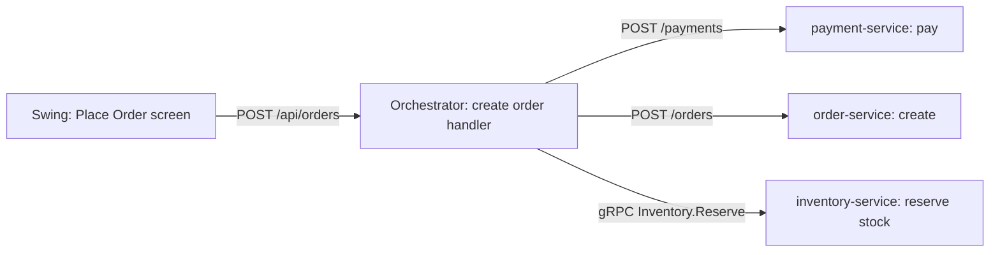
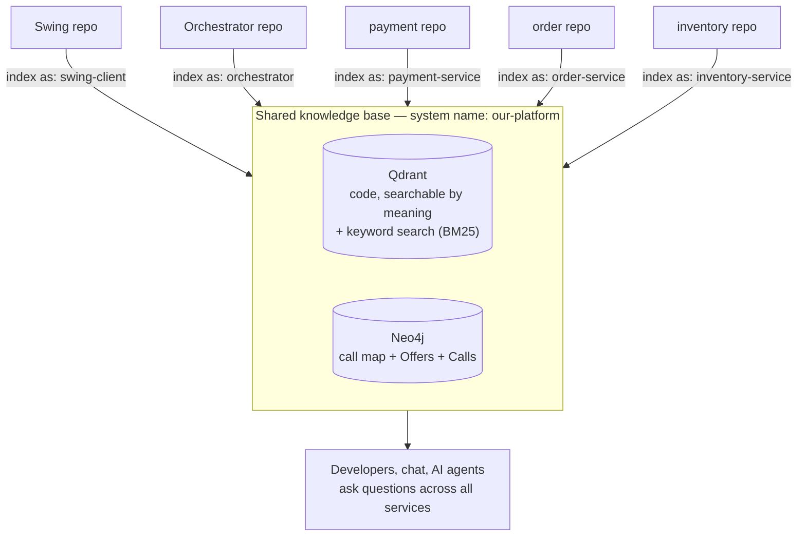

# Kitsune for Microservices — Design Proposal

> **Status:** proposal for review, with a working prototype of Phase 1 (service labels,
> Offers/Calls, matching, cross-service questions). The prototype was tested on four
> public microservice systems; see [Prototype results](#prototype-results). The open
> decisions in section 9 still apply before it becomes the production design.
> **Decision requested:** approve the approach and the open decisions in
> [section 9](#9-decisions-needed-from-the-architect), so implementation can start with Phase 1.

---

## 1. Summary

**Goal:** one knowledge graph that covers *all* our services — even when they live in
separate repositories and are written in different languages — so that we (and AI
coding agents) can ask questions like:

- *"If I change the payment API, which services and screens are affected?"*
- *"What happens, end to end, when a user clicks **Place Order**?"*

**How, in one sentence:** Kitsune reads each repository on its own into **one shared
knowledge base**, records for each service **what it offers** (its endpoints) and
**what it calls** on other services, and then **matches the two** to connect the
services.

**What we already have** ✅: Kitsune already understands the code *inside* a service
(functions, classes, who calls whom — measured at 100% on our call-graph tests), and it
already supports a shared server setup (Qdrant + Neo4j) with separate "systems"
(namespaces), tested on live servers.

**What is new:** labelling each service, finding endpoints and calls between services,
and the matching step that connects them.

---

## 2. Our example system

The rest of this document uses our real stack:



A user clicks **Place Order** in the Swing app → the Swing app calls the orchestrator →
the orchestrator calls the backend services (Spring Boot and Go).

Each box can be its **own Git repository**. That is fine — see section 4.

---

## 3. The problem

Inside one service, code is connected by **function calls**, and Kitsune already maps
those.

Between services, code is connected over the **network** — an HTTP request or a gRPC
call. To a code reader, that link is invisible: the Swing app contains the text
`"/api/orders"`, the Go orchestrator contains a route `"/api/orders"`, but nothing in
the code *directly* ties the two together.

So today Kitsune gives us **four separate maps** — one per service — with no roads
between them. It cannot answer *"what breaks in other services if I change this?"*

---

## 4. How it works

### The idea: offers and calls

For every service, Kitsune writes down two lists:

| | Meaning | Example |
|---|---|---|
| **Offers** | the endpoints this service exposes | orchestrator offers `POST /api/orders` |
| **Calls** | the endpoints of *other* services it uses | Swing client calls `POST /api/orders` |

Then it **matches every call to an offer**. Where they match, it draws a connection.
The services never need to know about each other — the connection comes from the
**addresses** written in the code (URL paths, gRPC service names, queue topics).

### The four steps



### Applied to our example

| Service | Offers | Calls |
|---|---|---|
| Swing client | — | `POST /api/orders` (from the Place Order screen) |
| Orchestrator (Go) | `POST /api/orders` | `POST /payments`, `POST /orders`, gRPC `Inventory.Reserve` |
| payment-service (Spring) | `POST /payments` | — |
| order-service (Spring) | `POST /orders` | — |
| inventory-service (Go) | gRPC `Inventory.Reserve` | — |

After matching:



Combined with what Kitsune already knows *inside* each service, this gives one map from
the button click down to every backend function involved.

### How Kitsune knows which service an address belongs to

A call like *"POST to `<payment URL>`/payments"* must be tied to payment-service. Kitsune
uses, in order:

1. **gRPC definitions** (`.proto` files) — they name the service and method exactly.
2. **Configuration** — e.g. Spring `application.properties`
   (`payment.url=http://payment-service:8080`), constants, environment variable names.
3. **A small mapping file** we maintain where the code is not enough, e.g.
   *"`PAYMENT_URL` means payment-service"*.

If none of these settle it, the connection is still recorded but marked **"possible"**
(see section 6) instead of being guessed.

---

## 5. The shared knowledge base (with separate repositories)



1. **One home.** A Qdrant + Neo4j server (✅ *supported and tested today*).
2. **One system name**, e.g. `our-platform` (✅ *namespaces exist today*), so several
   systems can share the same server without mixing.
3. **Each repository writes its own slice**, labelled with its service name (new). Repos
   can be indexed in any order, from any machine.
4. **The matching step runs after each update** and redraws only the connections
   between services. It compares lists of endpoints, not source code, so it is fast.
5. **Kept current by CI.** Each repository's pipeline (after every merge to main)
   re-indexes only that repository's changed files and re-runs matching. Alternative:
   one scheduled job that refreshes all repositories.
6. **Monorepo works the same way** — each service folder is one slice.

### Everything must live in the shared base — including keyword search

Kitsune searches code in two ways and combines them: **by meaning** (vectors in Qdrant)
and **by exact keywords** (BM25, which catches exact names like `PaymentController` that
meaning-based search can miss).

Today ✅ the vectors and the call map are stored on the shared server, but a few parts
are still **local files on the machine that ran the indexing**. In a shared setup, each
CI job or developer machine would then hold a different, partial copy:

| Part | Stored today | Problem when shared | Fix (in this proposal) |
|---|---|---|---|
| **Keyword search index (BM25)** | local file | each machine only has keywords for the repos it indexed | **move into Qdrant** (sparse vectors support BM25-style keyword search) — one shared index, searched together with meaning in one query |
| **"Which files changed" record** | local file | short-lived CI runners lose it → full re-index on every run | store per repository in the shared base |
| **Business concepts** (Payment, Order, …) | local file | computed from one repo, not the whole system | compute after matching, store in the shared base |
| **Answer cache** | local file | could serve stale answers after another repo updates | keep it local but clear it whenever the shared base changes (version stamp) |

**Alternative for keyword search:** Neo4j's built-in full-text index (also BM25-style).
We recommend Qdrant so both kinds of search live in one place and run as one query.

---

## 6. How reliable the connections are

| Kind of connection | Reliability | Why |
|---|---|---|
| gRPC | **High** | `.proto` files state service and method exactly |
| HTTP with paths written in code + URL from config/constant | **High** | path and target service both visible |
| Message queues (Kafka, RabbitMQ, SQS) — same topic name | **High** | topic name written in both services |
| HTTP where the URL only exists at runtime (service discovery, gateway rewrites, user input) | **Possible** | address not visible in code — needs a mapping-file entry |
| Two services using the same database table | **Coupling, not a call** | shown separately |

**Rule:** answers use the reliable connections by default and list the "possible" ones
separately, so nobody is misled. This is the same rule Kitsune already uses inside a
service today.

---

## 7. What we get

**Impact across services** — *"If I change `pay` in payment-service, what is affected?"*

```text
pay                              payment-service
 ▲  POST /payments
create order handler             orchestrator (Go)          handlers/order.go:31
 ▲  POST /api/orders
Place Order screen               Swing client               ui/OrderPanel.java:88
```

**End-to-end flows** — *"What happens when the user places an order?"* — Kitsune
follows the connections forward and gives the AI the relevant code from every service,
in order.

**Service map** — which service calls which, over what (HTTP / gRPC / queue).

**Dead endpoint candidates** — endpoints that no service calls.

---

## 8. Risks and limits

| Risk | Impact | Mitigation |
|---|---|---|
| URLs built only at runtime (service discovery, API gateway rewrites) | Some connections missing or "possible" | Mapping file; read gateway route config later |
| Route prefixes (e.g. Spring class-level `/api`) | Paths would not match | Combine prefixes before matching (in scope) |
| Frameworks we have not covered | No connections for that service | Add one extractor per framework; same pattern |
| Two pipelines updating at the same time | Inconsistent connections | Lock around the matching step |
| Keyword index (BM25) and some metadata are local files today | Each machine sees only part of the system in keyword search; CI re-indexes everything | Move them into the shared base (section 5) — part of Phase 1 |
| Whole system's code readable from one server | Access risk | Internal network + authentication on Qdrant/Neo4j |
| Infrastructure-only wiring (Istio, cron, cloud event rules) | Not visible in code | Out of scope for now |

Expected result: most connections in a typical HTTP / gRPC / queue system — **not 100%**.

---

## 9. Decisions needed from the architect

1. **Scope of the first version:** HTTP + gRPC only, or also message queues and shared
   databases?
2. **Where the shared knowledge base runs:** which server / environment hosts Qdrant +
   Neo4j, and who can access it.
3. **How it stays up to date:** each repository's CI updates its own slice, or one
   scheduled job for all?
4. **Mapping file ownership:** one central file, or one per repository?
5. **Which frameworks first:** confirm the list in section 10 matches what we actually use
   (e.g. which Go router, which Java HTTP client in the Swing app).

---

## 10. Implementation plan

Each phase is tested with a small sample system (Swing + Go + Spring) where the correct
answers are known in advance — the same way Kitsune's current quality tests work — so
progress is measured, not assumed.

| Phase | Delivers | Size |
|---|---|---|
| **1. Services** | service labels, one shared knowledge base (incl. keyword search moved into Qdrant, changed-files record and concepts stored centrally), search one or all services | Medium |
| **2. gRPC** | read `.proto` files, connect gRPC clients to servers | Medium |
| **3. HTTP** | find endpoints and HTTP calls for our frameworks (below), path matching, config reading, mapping file | Large |
| **4. Cross-service questions** | impact across services, end-to-end flows, service map | Medium |
| **5. Optional** | message queues, shared database tables | Medium |

**Frameworks covered in Phase 3 (to confirm):**

| Language | Endpoints (offers) | HTTP calls |
|---|---|---|
| Java Spring Boot | `@GetMapping`, `@PostMapping`, `@RequestMapping` (incl. class-level prefix) | `RestTemplate`, `WebClient`, Feign |
| Java Swing client | — | `java.net.http.HttpClient`, OkHttp, Apache HttpClient |
| Go | `net/http`, gin, chi, gorilla/mux | `http.Get/Post`, `http.NewRequest` |

Settings read for service URLs: Spring `application.properties` / `.yml`, environment
variable names, constants, and the mapping file.

---

## Appendix — technical details

<details>
<summary>Graph model</summary>

- **Nodes:** code (functions, classes — as today), `Service`, `Endpoint`
  (HTTP route or gRPC method), and later `Topic`, `Table`.
- **Connections:** today's `CALLS` (inside a service), plus `HTTP_CALLS`, `GRPC_CALLS`,
  `EXPOSES` (service → endpoint), and later `PUBLISHES`, `CONSUMED_BY`, `READS`,
  `WRITES`. Each cross-service connection is marked `confirmed` or `possible`.
- Every item carries its `service`, so questions can cover the whole system or one
  service.

</details>

<details>
<summary>Matching rules</summary>

- **HTTP:** target service + method + path. Path parameters (`{id}`, `:id`, `123`) are
  treated as "any value"; route prefixes are combined first.
- **gRPC:** proto package + service + method.
- **Queues:** topic / queue name.
- Inside a service, function calls are still resolved only within that service (plus
  shared libraries it imports), so two services that both have a `save()` function are
  never confused.

</details>

<details>
<summary>Example mapping file</summary>

```yaml
# kitsune.yaml — only for what the code and config don't already say
system: our-platform
services:
  swing-client:      { repo: swing-client }
  orchestrator:      { repo: orchestrator,      url_vars: [ORCH_URL] }
  payment-service:   { repo: payment-service,   url_vars: [PAYMENT_URL] }
  order-service:     { repo: order-service,     url_vars: [ORDER_URL] }
  inventory-service: { repo: inventory-service }
shared:
  - proto/          # .proto files used by several services
```

</details>

<details>
<summary>What exists today vs. what is new</summary>

| Capability | Status |
|---|---|
| Understand code inside a service (Java, Go, Python, JS/TS, …) | ✅ exists, quality-tested |
| Accurate call graph inside a service | ✅ exists (100% on current tests) |
| Shared server (Qdrant + Neo4j), separate systems (namespaces) | ✅ exists, tested on live servers |
| Keyword search (BM25) | ✅ exists — but as a local file; moving it into Qdrant is new |
| Incremental updates (only changed files) | ✅ exists |
| Service labels, Offers/Calls lists, matching, cross-service questions | ⚠️ prototype — tested on 4 public systems (below) |
| AI-agent access (MCP server) | ⚠️ experimental, not yet released |

</details>

### Prototype results

Four public systems, chosen to cover different styles. The correct answers were written
by hand from each project's source code, and two systems were kept unseen until the first
test run.

| System | Services | Languages / style | Links found (precision / recall) |
|---|---|---|---|
| Sock Shop | 8 repos | Java, Go, Node · HTTP + RabbitMQ | 100% / 100% |
| Online Boutique | 12 | Go, C#, Node, Python, Java · gRPC | 100% / 100% |
| Spring PetClinic Microservices *(unseen)* | 8 | Java · Spring Cloud gateway | 100% / 100% (first run: 0%) |
| Robot Shop *(unseen)* | 12 | Node, Java, Python, Go, PHP · HTTP + AMQP + nginx | 100% / 100% (first run: 17%) |

Also checked:

- No wrong links: 0 links to services that must not be connected.
- Impact questions such as "who is affected if cart changes?" are answered correctly in every system.
- The results are the same on the shared servers (Qdrant + Neo4j) and on the local setup.

**Read the unseen first runs as the honest number.** A new system with a style Kitsune has
not seen yet can start low. Each fix is generic, not tuned to one project, but the next new
style may need one too. Links whose URL is only known at run time are reported as
"possible", never as confirmed.

Reproduce with `python kitsune/eval/fetch_external.py` followed by
`python kitsune/eval/run_system_eval.py -v`.
