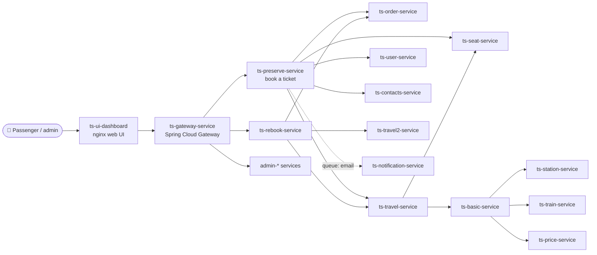
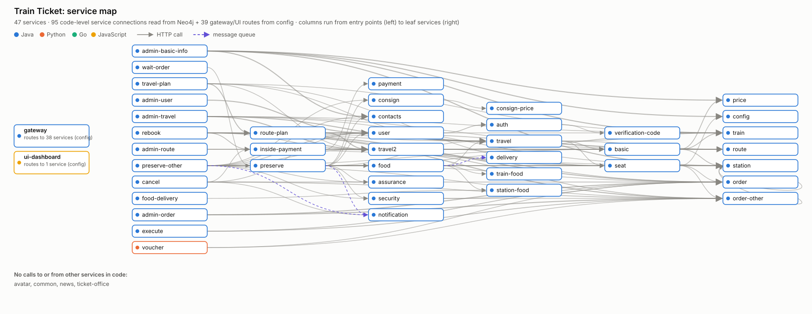
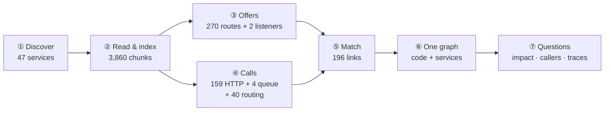
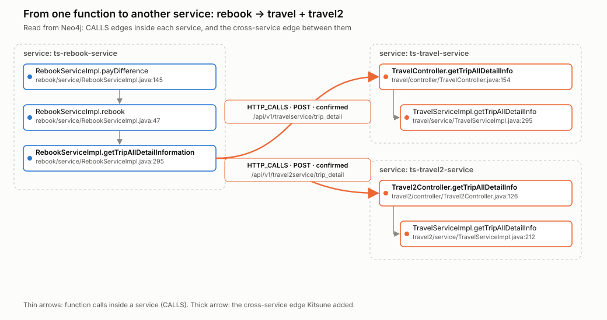
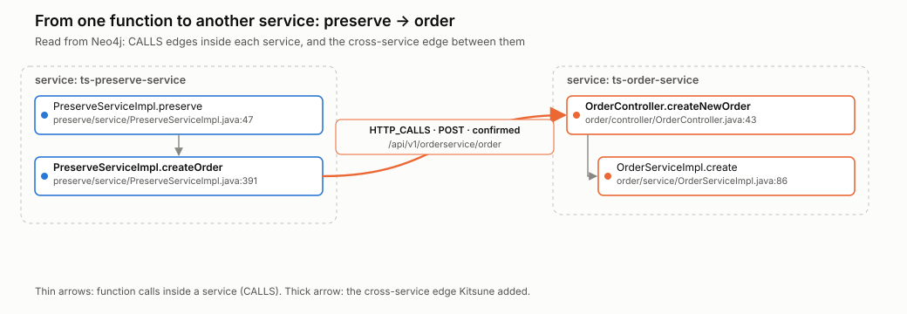
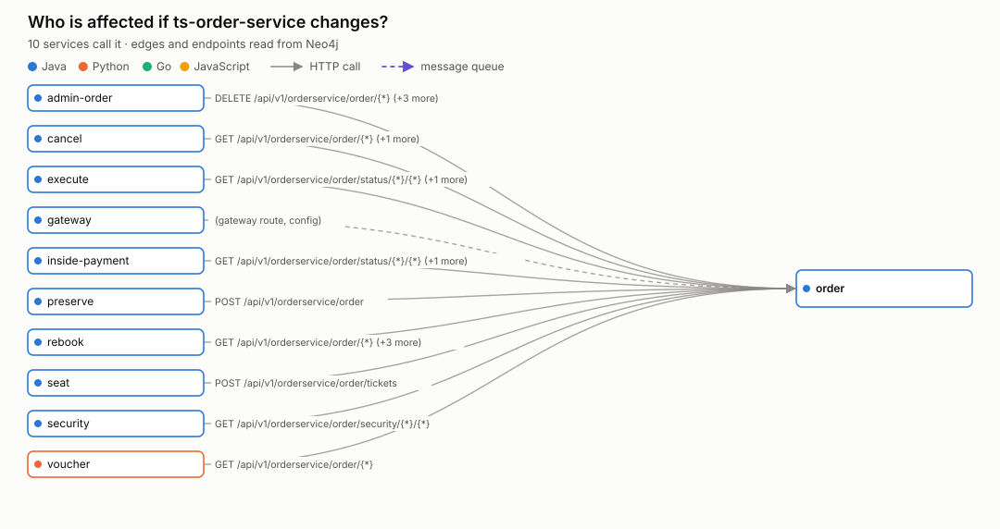
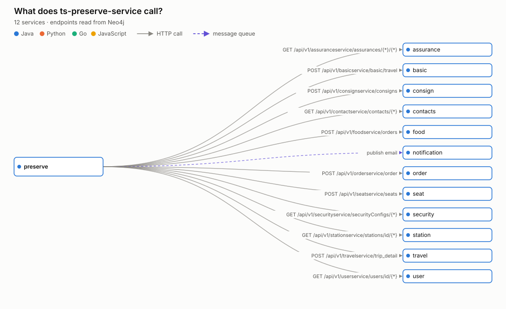
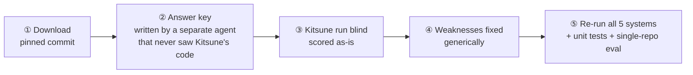
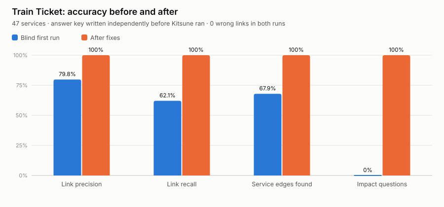
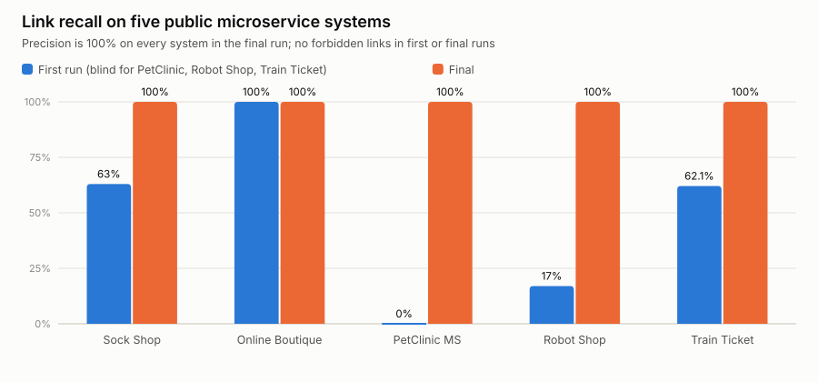

# 🚆 Kitsune on Train Ticket — How It Works and How It Performed

> **Train Ticket** (FudanSELab, Fudan University) is the best-known research benchmark for
> microservice systems: a railway booking platform made of ~40 services. This report shows,
> step by step with real data from the run, **how Kitsune turned 47 separate service folders
> into one connected knowledge graph**, how accurate that graph is, what the test exposed,
> and what was fixed.

## At a glance

| | |
|---|---|
| **System** | Train Ticket @ commit `313886e` (Nov 2022), 47 services, 4 languages |
| **What Kitsune built** | **3,860 code chunks** · **272 offers** (APIs and queue listeners) · **203 calls** · **196 cross-service links** · **134 service-to-service edges** |
| **Accuracy, blind first run** | precision **79.8%**, recall **62.1%**, wrong links **0** |
| **Accuracy, after fixes** | precision **100%**, recall **100%**, wrong links **0**, impact questions **5/5** |
| **Time** | 8 min 21 s to index everything on a 4-core laptop (20 s of that is service linking) |
| **Bonus** | Kitsune surfaced **two real bugs in Train Ticket**: calls to routes that don't exist or use the wrong HTTP method |
| **Pictures** | 5 graph images drawn from Kitsune's Neo4j graph, plus 2 accuracy charts |

**Contents:**
1. [The system under test](#1-the-system-under-test)
2. [How Kitsune worked on Train Ticket, step by step](#2-how-kitsune-worked-on-train-ticket-step-by-step)
3. [What you can ask it now](#3-what-you-can-ask-it-now)
4. [How it was tested](#4-how-it-was-tested)
5. [Results](#5-results)
6. [Weaknesses found and fixed](#6-weaknesses-found-and-fixed)
7. [What Kitsune flags as uncertain](#7-what-kitsune-flags-as-uncertain)
8. [Comparison with the other systems](#8-comparison-with-the-other-systems)
9. [Limits and next steps](#9-limits-and-next-steps)
10. [See it live in Neo4j](#10-see-it-live-in-neo4j)
11. [Reproduce](#11-reproduce)

---

## 1. The system under test

| | |
|---|---|
| Source | https://github.com/FudanSELab/train-ticket at `313886e` |
| Services | **47**: 42 Java (Spring Boot), 2 Python, 2 JavaScript (one is the nginx web UI), 1 Go |
| Code | about 530 Java files plus Python, JS and Go |
| How services talk | HTTP through Spring `RestTemplate.exchange`, RabbitMQ queues, and a Spring Cloud **gateway** in front |
| Not code | `deployment/`, `hack/`, `old-docs/` and similar folders, which Kitsune skips |


*Part of the real dependency graph Kitsune reconstructed. The full graph has 134 edges.*

**The full service map, read straight from Kitsune's Neo4j graph:**



*Every box is a service, colored by language. Every arrow is a real call found in the code
(dashed purple = RabbitMQ). Columns run from entry points on the left to leaf services on
the right. The gateway's 38 routes come from its config and are summarised in its box,
because drawing them would hide everything else.*

---

## 2. How Kitsune worked on Train Ticket, step by step

One command does everything:

```python
engine = RepositoryKnowledgeEngine(namespace="train-ticket")
engine.index_system("eval/external/train-ticket")
```



### ① Discover the services (0.1 s)

Kitsune walks the folder and treats every directory with a build manifest (`pom.xml`,
`package.json`, `requirements.txt`, `go.mod`, a Dockerfile…) as a service. The name comes from
`spring.application.name` when there is one.

- **Found: 47 services.** 42 Java, 2 Python, 2 JavaScript, 1 Go.
- **Skipped:** `deployment/`, `hack/`, and the old sample projects in `old-docs/`, which are documentation, not services.

### ② Read and index every service (8 min)

Each service is parsed with tree-sitter into whole functions and classes (*chunks*), and every
chunk is labelled with its service.

- **3,860 chunks** stored three ways: by meaning (vectors), by structure (graph) and by exact words (BM25).
- Calls **inside** each service are resolved per service, so two services that both have a `create()` are never confused.
- Embedding the code is about 95% of the time.

### ③ Find what each service *offers* (APIs and listeners)

Kitsune reads the Spring annotations, joining the class prefix and the method path:

```java
// ts-order-service/.../controller/OrderController.java
@RequestMapping("/api/v1/orderservice")         // class prefix
public class OrderController {
    @PostMapping(path = "/order")                // → offer: POST /api/v1/orderservice/order
    public HttpEntity createNewOrder(...)        //   handler: line 43
```

**Found: 270 HTTP routes and 2 queue listeners** (`@RabbitListener`).

### ④ Find what each service *calls*, by working out each URL like the program would

This is the hard part: URLs are built in code, not written out. Real examples from Train Ticket:

| Pattern in Train Ticket | Code | Kitsune evaluates to |
|---|---|---|
| **Helper + verb as an argument** | `getServiceUrl("ts-order-service")` (returns `"http://" + name`), then `exchange(url + "/api/v1/orderservice/order", HttpMethod.POST, …)` | `POST http://ts-order-service/api/v1/orderservice/order` |
| **If/else picks the target** | `if (tripId.startsWith("G")) url = travel…/trip_detail; else url = travel2…/trip_detail;` | **both**: `POST ts-travel-service/…` and `POST ts-travel2-service/…` |
| **Base URL passed into a helper** | `doPreserve(service_url, …)` → `exchange(url + "/api/v1/contactservice/preserve", HttpMethod.POST, …)` | `POST http://ts-preserve-service/api/v1/contactservice/preserve` |
| **Python service** | `order_url = 'http://ts-order-service:12031'` … `urllib.request.Request(url=order_url + '/api/v1/orderservice/order/' + orderId)` | `GET ts-order-service /api/v1/orderservice/order/{*}` |
| **RabbitMQ** | `rabbitTemplate.convertAndSend(Queues.queueName, val)` with `queueName = "food_delivery"` | publish to `food_delivery` |
| **Gateway routes (config)** | `uri: lb://${ORDER_SERVICE_HOST:ts-order-service}` | gateway → `ts-order-service` |

**The if/else case, as stored in Neo4j:** one function, two target services, both found.



**Found: 159 HTTP calls in code, 4 queue publishes, and 40 routing entries** (39 gateway routes + the nginx UI → gateway): 203 in total.

### ⑤ Match calls to offers

| Call type | Matched by | Links found |
|---|---|---|
| HTTP | host + HTTP verb + path (`{*}` matches a path variable) | **153** unique endpoint links, all confirmed |
| Queue | queue name | **3** (food → delivery, preserve and preserve-other → notification) |
| Gateway / UI routing | service named in the route | **40** service-level links |
| Doubtful | no route, or verb mismatch | **3** marked **possible**, never confirmed ([section 7](#7-what-kitsune-flags-as-uncertain)) |

**Every link records both ends.** Real example:

```text
ts-preserve-service → ts-order-service    [HTTP POST /api/v1/orderservice/order]   CONFIRMED
  caller : ts-preserve-service/src/main/java/preserve/service/PreserveServiceImpl.java:396
           in createOrder()
  handler: ts-order-service/src/main/java/order/controller/OrderController.java:43
           in createNewOrder()
  reason : HTTP call matched by host, method and path
```

### ⑥ One graph

Service links are stored as `HTTP_CALLS` and `MESSAGES` edges in the **same graph** as the
function-level `CALLS` edges. A question can therefore walk from a function in one service,
across the network, into the handler in another.



*Booking a ticket, as stored in Neo4j: `PreserveServiceImpl.preserve` calls `createOrder`.
That function sends `POST /api/v1/orderservice/order`, which Kitsune connects to
`OrderController.createNewOrder` in another service. The controller calls `OrderService.create`
through an interface, and Kitsune follows the `@Service` bean to `OrderServiceImpl.create`.
That is dependency injection resolved across a service boundary.*

| Most depended-on services | Callers | | Most outgoing calls | Services called |
|---|---|---|---|---|
| ts-order-service | 10 | | ts-gateway-service | 38 |
| ts-order-other-service | 10 | | ts-preserve-service | 12 |
| ts-station-service | 9 | | ts-preserve-other-service | 12 |
| ts-train-service | 8 | | ts-rebook-service | 8 |
| ts-route-service | 8 | | ts-cancel-service | 5 |
| ts-seat-service | 7 | | ts-travel-plan-service | 5 |
| ts-travel-service | 7 | | ts-admin-travel-service | 5 |

18 services make no outgoing calls. They are the "leaf" services, such as station, train, price and config.

---

## 3. What you can ask it now

| Question | Kitsune's answer (verified against the answer key) |
|---|---|
| *"Which services are affected if **ts-order-service** changes?"* | admin-order, cancel, execute, gateway, inside-payment, preserve, rebook, seat, security, voucher (**10**, exact) |
| *"…if **ts-station-service** changes?"* | admin-basic-info, admin-route, admin-travel, basic, gateway, order, order-other, preserve, preserve-other (**9**, exact) |
| *"…if **ts-user-service** changes?"* | admin-user, cancel, gateway, preserve, preserve-other (**5**, exact) |
| *"…if **ts-travel-service** changes?"* | admin-travel, food, gateway, preserve, rebook, route-plan, travel-plan (**7**, exact) |
| *"…if **ts-seat-service** changes?"* | gateway, preserve, preserve-other, rebook, travel, travel2, travel-plan (**7**, exact) |
| *"Who calls `POST /api/v1/orderservice/order`?"* | `engine.get_endpoint_callers(...)` returns each caller with **file and line** |
| *"What does booking a ticket touch?"* | preserve → order, travel, seat, user, contacts, security, food, consign, assurance, station and basic, plus the `email` queue |





```python
engine.get_service_links("ts-order-service", "in")          # who depends on order
engine.get_endpoint_callers("/api/v1/orderservice/order", "POST")
engine.service_map()                                         # the whole graph, with endpoints
engine.ask("If I change the order creation API, what breaks?")  # plain-English answer
```

---

## 4. How it was tested



**The answer key:**
- 153 endpoint links, 40 service-level edges, 10 "must not exist" pairs and 5 impact questions.
- Every HTTP link was checked against the target controller's real route, and 17 controllers were also checked by hand.
- **Traps:** some "must not exist" pairs look connected. For example, URL properties in config files that no code reads. They catch a tool that guesses.
- **One correction, made after the blind run and recorded inside the key.** The key wrote seat→config as `/configs/{*}`, but the code uses a fixed constant (`"DirectTicketAllocationProportion"`), so the path really called is literal.

**What the scores mean:**

| Metric | Meaning |
|---|---|
| Link precision | Of the links Kitsune confirmed, how many are real |
| Link recall | Of the real links, how many Kitsune confirmed |
| Wrong links | Links between pairs that must not be connected (should be 0) |
| Impact accuracy | "Who is affected if X changes" answered exactly right |

---

## 5. Results



| | Precision | Recall | Service edges found | Wrong links | Impact |
|---|---|---|---|---|---|
| **Blind first run** | 79.8% | 62.1% | 67.9% | 0 | 0 / 5 |
| **After fixes** | **100%** | **100%** | **100%** | **0** | **5 / 5** |

### How the score moved

| Step | Precision | Recall | Wrong links |
|---|---|---|---|
| Blind run | 79.8% | 62.1% | 0 |
| + verbs (#1), scoped locals (#2), branches (#3), gateway placeholders (#8) | 89.3% | 92.8% | **2**: trap pairs, from fix #8 reading plain config |
| + config only from gateways (#9), responses aren't URLs (#6) | 100% | 92.8% | 0 |
| + class prefix (#7), parameters (#5), regex (#10), docs folders (#11) | 99.3% | 99.3% | 0 |
| + the one answer-key correction (section 4) | **100%** | **100%** | 0 |

> **How to read this:** the **blind 62% recall** is the honest expectation for a brand-new
> code style. The **100%** shows that the gaps were real, general and fixable. It is not a
> second blind test. Even in the blind run, **no wrong links** were made.

---

## 6. Weaknesses found and fixed

Every fix is a general rule about real code, covered by a unit test. None is a Train Ticket special case.

| # | Weakness | Real-code pattern | Fix |
|---|---|---|---|
| 1 | HTTP verb not read from arguments | `restTemplate.exchange(url, HttpMethod.POST, …)`, the most common RestTemplate call | Verb read from `HttpMethod.X` / `http.MethodX` |
| 2 | Variables read file-wide | Many methods reuse names like `url`, `requestUrl` | A local takes its value from **its own function** first |
| 3 | If/else targets: only one kept | `if (G/D trip) url = travel… else url = travel2…` | **Every branch** becomes a call |
| 4 | URL helpers evaluated without their arguments | `getServiceUrl("ts-order-service")` | Call arguments bound to the helper's parameters |
| 5 | Base URL passed as a parameter | `doPreserve(serviceUrl, …)` | A parameter takes the value its callers pass |
| 6 | Response mistaken for a URL | `re = exchange(…)` then `re.getBody()` | A request's result is never a URL |
| 7 | Class prefix without a leading `/` | `@RequestMapping("api/v1/contactservice")` | Accepted, as Spring does |
| 8 | Gateway placeholders not resolved | `lb://${ORDER_SERVICE_HOST:ts-order-service}` | Resolved like Spring (default value) |
| 9 | Plain URL properties treated as routes *(caught by traps)* | `order.url: http://…` read by no code | Only **gateway** route tables count |
| 10 | Regex route read as a URL | Go `"/(.*)"` | Regex strings are not URLs; an all-wildcard path can't identify a service |
| 11 | Docs folders counted as services | `old-docs/…` | Skipped |
| 12 | Python keyword arguments ignored | `Request(url=url)` | `url=` / `uri=` values evaluated |

**Found while loading Train Ticket into Neo4j for this report:**

| # | Weakness | What happened | Fix |
|---|---|---|---|
| 13 | **Java class annotations not read** | `@Service`, `@RestController` on a class sit inside its `modifiers`, and a bare `@Service` is a `marker_annotation`. Neither was read, so dependency injection stopped at the interface (`OrderService.create`) instead of the bean (`OrderServiceImpl.create`). Python decorators on a `decorated_definition` were missed the same way. The old DI unit test passed only because it supplied annotations by hand | Annotations read from `modifiers`, `marker_annotation` and `decorated_definition`; new tests parse **real Java and Python source** |
| 14 | **Huge node names broke the Neo4j load** | In `Mockito.when(restTemplate.exchange(…)).thenReturn(…)`, the whole expression became an external node's name: 11 KB in Train Ticket's tests. Neo4j can't index values over ~8 KB, so the whole load aborted | Names keep only the call chain (`org.mockito.Mockito::when.thenReturn`), plus a 300-character safety cap |
| 15 | **Java fields with generic names not typed** | `@Autowired private TravelService service;` then `service.getTripAllDetailInfo(…)`. In Java a bare `service` means `this.service`, but the resolver only matched variable names to class names (`orderService` ≈ `OrderService`), so `service` stayed **ambiguous** across 3 candidates | A bare receiver in Java/C++ takes the enclosing class's field type; test added |

Neither affected the link scores above: service links come from contract extraction, which
reads annotations its own way. Both matter for the code-level graph and for production loads.

Fix #4 was found by the new unit test, not by Train Ticket. On Train Ticket, the
`getServiceUrl("ts-…")` pattern only worked by luck: the long service names won a tie-break
that short names lose.

---

## 7. What Kitsune flags as uncertain

Kitsune never guesses. On Train Ticket it reports:

| Kind | What | Verdict |
|---|---|---|
| ⚠️ **Call to a missing route** | `wait-order → preserve POST /api/v1/contactservice/preserve` (`PollThread.java:75`) | **Real bug in Train Ticket.** preserve only serves `/api/v1/preserveservice/preserve` |
| ⚠️ **Possible, not confirmed** | `rebook → order POST /order/{*}` and `rebook → order-other POST /orderOther/{*}` (`RebookServiceImpl.java:371`) | **Real bug in Train Ticket.** Those paths only accept GET and DELETE. Kitsune doesn't confirm them, though its stated reason ("several routes match") could be more precise |
| 🕳️ Blind spot | `ORDER_SERVICE_URL`, `ORDER_OTHER_SERVICE_URL` (voucher) | Optional deploy-time overrides. The defaults are linked |
| 🕳️ Blind spot | `TICKET_OFFICE_MYSQL_HOST` | A database, not a service |

---

## 8. Comparison with the other systems



All five systems after the fixes, measured with full indexing on a 4-core laptop:

| System | Services | Shape | Precision | Recall | Wrong links | Impact | First run (blind) | Index time |
|---|---|---|---|---|---|---|---|---|
| Sock Shop | 8 | Java, Go, Node · HTTP + RabbitMQ | 100% | 100% | 0 | 3/3 | 63% recall | 158 s |
| Online Boutique | 12 | 5 languages · gRPC | 100% | 100% | 0 | 3/3 | 100% | 74 s |
| PetClinic Microservices | 8 | Spring Cloud gateway | 100% | 100% | 0 | 3/3 | 0% | 68 s |
| Robot Shop | 12 | 5 languages · HTTP + AMQP + nginx | 100% | 100% | 0 | 3/3 | 17% | 33 s |
| **Train Ticket** | **47** | **RestTemplate + RabbitMQ + gateway** | **100%** | **100%** | **0** | **5/5** | **62% recall, 80% precision** | **501 s** |

**Checks after the fixes:**
- **Unit tests:** 60 pass.
- **Single repository (44 questions):** retrieval recall 97.5% and call graph 100%, both unchanged.
- **Top-3 retrieval hits:** dropped from 90% to 85%. That is 1 question of 20, where the right code is still found but now ranks 4th or lower. The likely cause is that real decorators (fix #13) now appear in the text that is embedded. This is within noise, but it's reported here.

---

## 9. Limits and next steps

| Limit | Next step |
|---|---|
| The 100% is after fixing; a new code style can start lower | Same process: blind run → general fixes, or lessons taught through the lore |
| 8 minutes on a laptop CPU for 3,860 chunks | GPU or faster embedding for bigger systems |
| Feign `@FeignClient` interfaces not read | Add Feign support |
| `@Qualifier` / `@Primary` not used to choose beans | Read them in dependency-injection resolution |
| Java enums not chunked; PHP, Kotlin and C# not parsed | Chunker and grammar additions |
| The "possible" reason for verb mismatches is vague | Say "route exists but not for this HTTP method" |

---

## 10. See it live in Neo4j

Train Ticket is loaded in the local Neo4j under namespace `train_ticket`. Open Neo4j Browser at
http://localhost:7474 and run:

```cypher
// Which service calls which (one row per pair)
MATCH (a:Chunk {ns:'train_ticket'})-[r:HTTP_CALLS|MESSAGES]->(b:Chunk {ns:'train_ticket'})
RETURN a.service AS from, b.service AS to, type(r) AS kind, count(*) AS calls ORDER BY calls DESC

// The graph view: functions calling across services
MATCH p = (:Chunk {ns:'train_ticket'})-[:HTTP_CALLS|MESSAGES]->(:Chunk {ns:'train_ticket'})
RETURN p LIMIT 80

// Impact: everything that calls into ts-order-service
MATCH p = (:Chunk {ns:'train_ticket'})-[:HTTP_CALLS]->(:Chunk {ns:'train_ticket', service:'ts-order-service'})
RETURN p

// Booking end to end: calls inside preserve → HTTP → order → its implementation
MATCH p = (:Chunk {ns:'train_ticket'})-[:CALLS*0..2]->(a:Chunk {ns:'train_ticket', service:'ts-preserve-service'})
          -[:HTTP_CALLS]->(b:Chunk {ns:'train_ticket', service:'ts-order-service'})-[:CALLS*0..1]->()
RETURN p LIMIT 25
```

The images in this report were drawn from the same graph with
`eval/render_system_images.py` and `eval/render_eval_charts.py`.

## 11. Reproduce

```bash
python kitsune/eval/fetch_external.py                              # all 5 systems, pinned commits
python kitsune/eval/run_system_eval.py --system train-ticket -v    # Train Ticket only (~9 min)
python kitsune/eval/run_system_eval.py -v                          # all five (~15 min)
```

- **Answer key:** `eval/system_questions.json` → `"train-ticket"`.
- **Tests for the new behaviour:** `tests/test_services.py` (`test_spring_rest_template_patterns`, `test_gateway_routes_but_not_plain_url_properties`).
- **Further reading:** [KITSUNE.md](KITSUNE.md) (architecture) · [ARCHITECT_QA.md](ARCHITECT_QA.md) (DI, annotations, libraries, multi-repo).
